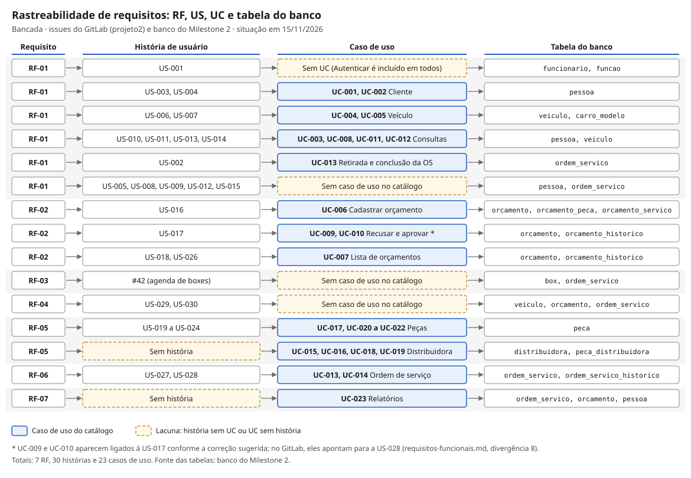

# Backlog priorizado

Milestone 1 · Fábrica de Software I · Unidade de requisitos

Backlog do produto Bancada, ordenado por prioridade MoSCoW e, dentro de cada classe, pela ordem do fluxo da oficina (balcão → orçamento → OS → box → histórico → estoque → relatório). Cada item aponta para as histórias (US), os casos de uso (UC) e os requisitos não funcionais (RNF) que afeta.

## Premissas

- **Fonte.** Os itens vêm das issues do GitLab. As histórias e os casos de uso usam os mesmos IDs de [historias-de-usuario.md](historias-de-usuario.md) e [requisitos-funcionais.md](requisitos-funcionais.md).
- **Prioridade.** MoSCoW convertido da label `prio::` da história de maior prioridade do item (P1 = Must, P2 = Should, P3 = Could).
- **Estado.** Não há código da aplicação no repositório. O estado indica até onde o item foi especificado e modelado: requisito e histórias (Milestone 1), caso de uso e diagrama de sequência (Milestone 2), diagrama de atividades ou de estados (Milestone 3).
- **Milestones.** Milestone 1 (15/09/2026): requisitos e protótipo. Milestone 2 (20/10/2026): casos de uso, sequência e banco. Milestone 3 (08/12/2026): atividades, estados e documentação final.

## Rastreabilidade

O diagrama liga cada RF às suas histórias e aos casos de uso. Os itens abaixo usam os mesmos IDs.

## Must

| ID | Item | Histórias | UC | RNF | Estado |
|---|---|---|---|---|---|
| BL-01 | Autenticação da secretária | US-001 | (incluído em todos) | RNF-02 | Especificado; sem UC próprio |
| BL-02 | Cadastro de cliente e de veículo | US-003, US-006 | UC-001, UC-004 | RNF-05 | Modelado (DS e DA) |
| BL-03 | Montagem do orçamento | US-016 | UC-006 | RNF-05 | Em modelagem (DA-004 aberto) |
| BL-04 | Decisão do cliente sobre o orçamento | US-017 | UC-009, UC-010 | RNF-02 | Em modelagem (DE-002 vazio) |
| BL-05 | Criação e status da OS | US-008, US-027, US-028 | UC-013, UC-014 | RNF-02, RNF-05 | Em modelagem (DA-005 aberto) |
| BL-06 | Designação de box e mecânico | #42 | Nenhum | RNF-05 | Especificado; sem UC |
| BL-07 | Histórico do veículo por placa | US-029 | Nenhum | RNF-03 | Especificado; sem UC |
| BL-08 | Cadastro, consulta, edição e exclusão de peças | US-019, US-020, US-021, US-022 | UC-017, UC-020, UC-021, UC-022 | RNF-05 | Especificado; UC sem diagramas |
| BL-09 | Filtro de peças e alerta de estoque baixo | US-023, US-024 | UC-020 | RNF-03 | Especificado; UC sem diagramas |
| BL-10 | Relatório da ordem de serviço | Nenhuma | UC-023 | RNF-03 | Especificado; sem história |

## Should

| ID | Item | Histórias | UC | RNF | Estado |
|---|---|---|---|---|---|
| BL-11 | Consulta e atualização de clientes e veículos | US-004, US-005, US-007, US-010, US-011, US-013, US-014 | UC-002, UC-003, UC-005, UC-008, UC-011, UC-012 | RNF-01, RNF-05 | Modelado (DS e DA) |
| BL-12 | Retirada do veículo | US-002 | UC-013 | RNF-02 | Modelado (DS e DE) |
| BL-13 | Consulta e atualização da OS | US-009, US-012, US-015 | Nenhum (DS com `UC-000`) | RNF-01 | Em modelagem (DS-020 aberto) |
| BL-14 | Histórico e filtro de orçamentos | US-018, US-026 | UC-007 | RNF-02 | Em modelagem (DS-016 aberto) |

## Could

| ID | Item | Histórias | UC | RNF | Estado |
|---|---|---|---|---|---|
| BL-15 | Orientação inicial na tela de histórico do veículo | US-030 | Nenhum | RNF-01 | Especificado; sem UC |

## Cobertura por artefato

Situação de cada caso de uso no GitLab e no Figma em 15/11/2026. "Aberto" indica issue ainda não fechada; "vazio no Figma" indica issue fechada com quadro sem diagrama (ver [lacunas](../07-rastreabilidade/lacunas.md), L-05).

| UC | Caso de uso | US (GitLab) | Sequência | Atividades ou estados |
|---|---|---|---|---|
| UC-001 | Cadastro de cliente | US-003 | DS-001 | DA-001 |
| UC-002 | Atualizar informações do cliente | US-004 | DS-005 | DA-002 |
| UC-003 | Visualizar lista de clientes cadastrados | US-010 | DS-009 | DA-008 |
| UC-004 | Cadastro de um veículo | US-006 | DS-002 | DA-003 |
| UC-005 | Atualizar informações do veículo | US-007 | DS-006 | DA-006 |
| UC-006 | Cadastrar orçamento | US-016 | DS-003 | DA-004 (aberto) |
| UC-007 | Visualizar lista de orçamentos feitos | US-000 | DS-016 (issue aberta) | DA-013 |
| UC-008 | Visualizar lista de veículos cadastrados | US-011 | DS-014 | DA-011 |
| UC-009 | Mudar o status do orçamento para recusado | US-028 | DS-013 | DE-003 |
| UC-010 | Mudar o status do orçamento para aprovado | US-028 | DS-012 | DE-002 (vazio no Figma) |
| UC-011 | Visualizar perfil do cliente | US-013 | DS-018 | DA-015 |
| UC-012 | Visualizar informações do veículo | US-014 | DS-015 | DA-012 |
| UC-013 | Mudar status de uma OS para concluída | US-002 | DS-008 | DE-001 |
| UC-014 | Criar OS | US-028 | DS-004 | DA-005 (aberto) |
| UC-015 | Cadastrar distribuidora | US-000 | DS-010 | DA-009 (vazio no Figma) |
| UC-016 | Atualizar informações da distribuidora | US-000 | DS-011 | DA-010 |
| UC-017 | Cadastrar peça | US-019 | Nenhum | Nenhum |
| UC-018 | Visualizar lista de distribuidoras | US-000 | Nenhum | Nenhum |
| UC-019 | Visualizar informações da distribuidora | US-000 | Nenhum | Nenhum |
| UC-020 | Visualizar lista de peças | US-000 | Nenhum | Nenhum |
| UC-021 | Visualizar informações da peça | US-020 | Nenhum | Nenhum |
| UC-022 | Atualizar informações da peça | US-021 | Nenhum | Nenhum |
| UC-023 | Visualizar lista de relatórios | US-000 | Nenhum | Nenhum |

Diagramas sem caso de uso no catálogo (marcados como `UC-000` no GitLab):

| Diagrama | Assunto | Atividades |
|---|---|---|
| DS-007 | Atualizar informações do orçamento | DA-007 (aberto) |
| DS-017 | Listar ordens de serviço cadastradas | DA-014 |
| DS-019 | Visualizar as informações do orçamento | DA-016 |
| DS-020 | Visualizar as informações da OS (aberto) | Nenhum |

Resumo: 16 dos 23 casos de uso têm diagrama de sequência. Os sete sem diagrama são os de estoque (UC-017, UC-020 a UC-022), de distribuidora (UC-018 e UC-019) e de relatório (UC-023).

## Itens sem requisito: decisão de escopo pendente

Estes itens aparecem na ata da reunião com o cliente ou no banco, mas não têm RF nem história. Até a equipe decidir, não entram no backlog.

| Item | Onde aparece | Decisão necessária |
|---|---|---|
| Distribuidoras | UC-015, UC-016, UC-018, UC-019; tabelas `distribuidora` e `peca_distribuidora` | Criar histórias na RF-05 ou reduzir a "fornecedor" da peça (pergunta 7 da RFP) |
| Pagamento, inclusive parcelado | Ata de 26/08; tabelas `pagamento` e `pagamento_parcelas` | Criar RF próprio ou tirar do escopo (pergunta 6 da RFP) |
| Peças trazidas pelo cliente | Ata de 26/08 | Criar regra na RF-02 (cobrança só da mão de obra) |
| Retirada apenas por quem entregou o veículo | Ata de 26/08 | Incluir na RF-01 e na US-002 |
| Tabela de preços alterada só pela gerência e pelo financeiro | Ata de 26/08; perfis Almoxarifado e Gerente/Financeiro | Depende de haver outros perfis de login (pergunta 8 da RFP) |

## Definição de Preparado (Definition of Ready)

Uma história só entra em uma milestone quando:

1. O título segue o padrão `US-0XX - RF-0Y - <nome>`, com número único.
2. O texto tem o formato **Como** / **quero** / **para**, com ator do catálogo (ACT-01 a ACT-03).
3. Os critérios de aceite usam a estrutura completa `Dado` / `Quando` / `Então` / `E`, com resultado observável.
4. A issue tem as labels `prio::`, `size::` e `type::` e está ligada ao RF de origem.
5. A regra foi conferida com o banco ([06-banco-de-dados](../06-banco-de-dados/README.md)); conflitos foram registrados em Divergências.

## Definição de Pronto (Definition of Done)

Um item de modelagem só é concluído quando:

1. O diagrama está no arquivo do Figma "Gestão de Oficina Mecânica", na página correspondente.
2. A issue tem a seção "Diagrama" com o link para o quadro no Figma, e o título do quadro tem link de volta para a issue.
3. O título da issue segue o padrão de rastreabilidade (`DS-0XX | UC-0YY - <nome>`, `DA-0XX | DS-0YY - <nome>`).
4. A documentação desta pasta e a [matriz de rastreabilidade](../07-rastreabilidade/matriz.md) estão atualizadas.
5. Outro integrante revisou o artefato antes do fechamento da issue.

## Veja também

- [Requisitos funcionais](requisitos-funcionais.md)
- [Requisitos não funcionais](requisitos-nao-funcionais.md)
- [Histórias de usuário](historias-de-usuario.md)
- [Rastreabilidade de requisitos](rastreabilidade-requisitos.svg)
- [Processo de desenvolvimento](../02-processo/README.md)
- [Casos de uso](../05-modelagem/casos-de-uso/README.md)
- [Milestone 1](../09-entregas/milestone-1.md)
- [Milestone 3](../09-entregas/milestone-3.md)
- [Template de história de usuário](../templates/historia-de-usuario.md)
