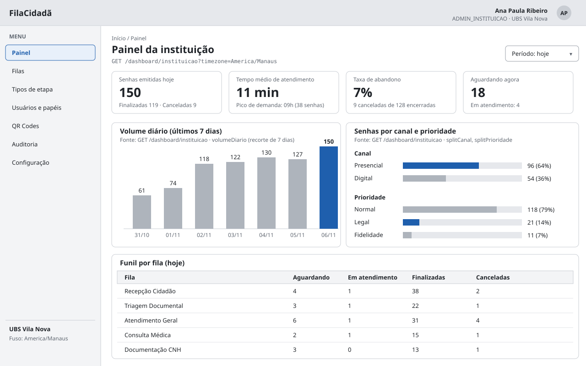
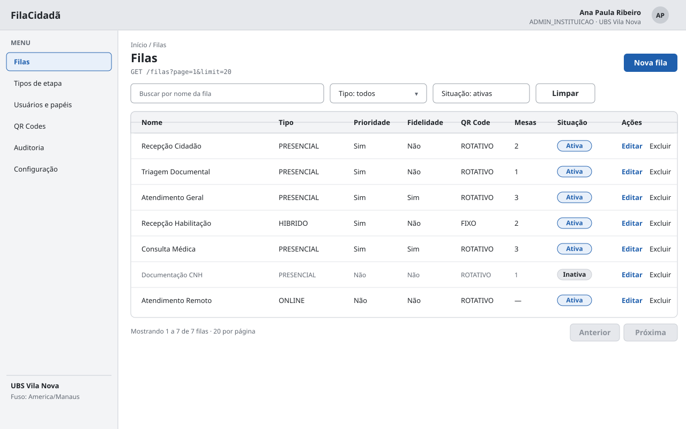
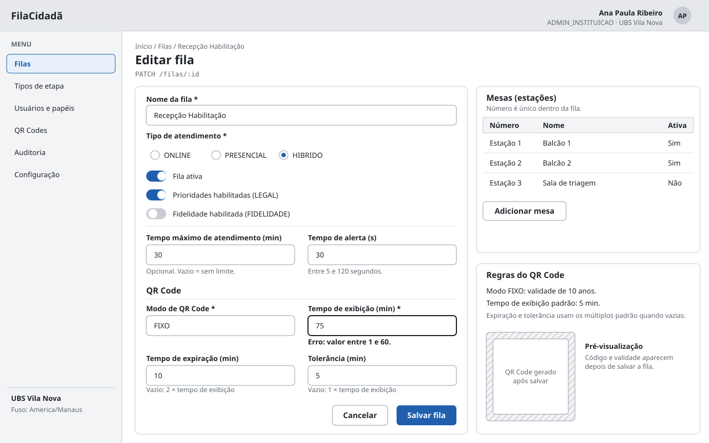
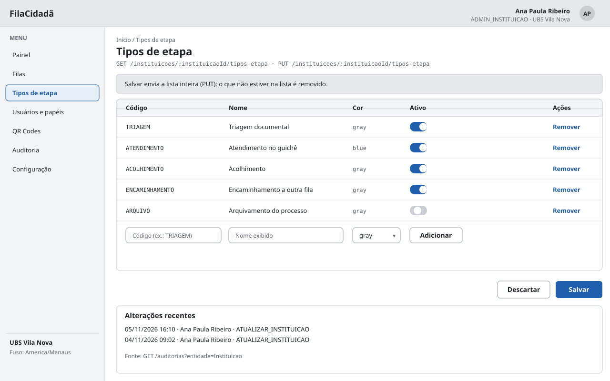
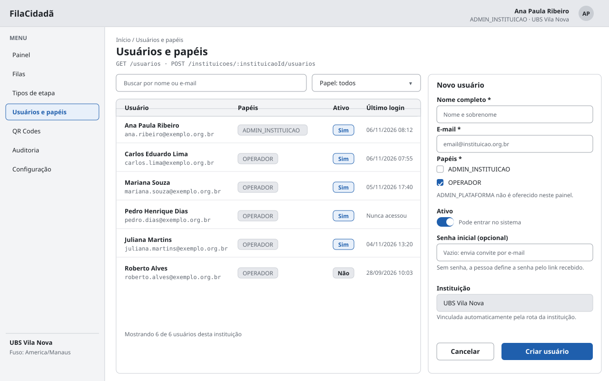
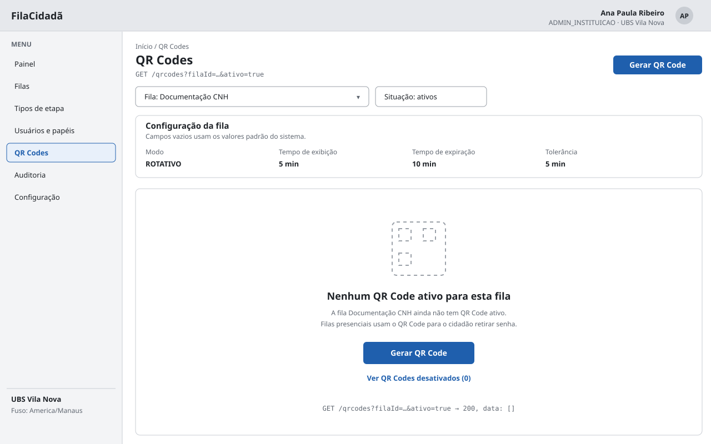
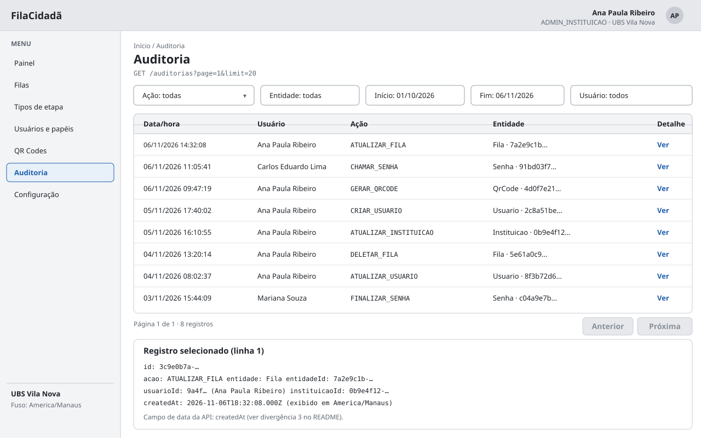
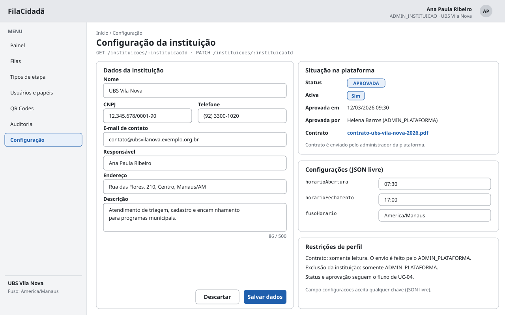
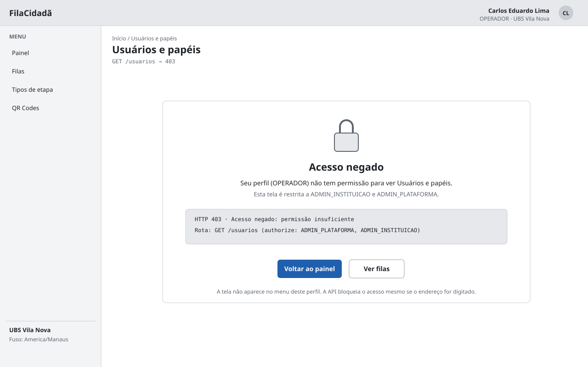

# Wireframes do administrador da instituição (ADI)

Milestone 2 · Protótipo de interface · Fábrica de Software I

Telas do ator ACT-03 (Administrador da Instituição, papel `ADMIN_INSTITUICAO`) e, na tela ADI-09, o estado de acesso negado para o ACT-02 (Operador, papel `OPERADOR`). Desktop 1280 x 800, média fidelidade, tons de cinza com um acento azul. Rótulos, campos e mensagens seguem as rotas, os schemas Zod e o `schema.prisma` do projeto.

Os IDs de US seguem a convenção do briefing (`US-0NN`, na ordem dos UC). A frente de histórias ainda não publicou a lista final, então a coluna US fica como "pendente". Enquanto `docs/03-requisitos/requisitos-funcionais.md` não traz o mapeamento UC para RF, as telas citam só UC e US.

## Tabela de telas

| Tela | Arquivo | Ator | UC | US | Estado exibido |
|---|---|---|---|---|---|
| ADI-01 Painel da instituição | [01-dashboard.svg](01-dashboard.svg) | ACT-03 | UC-13 | pendente | Populado (`GET /dashboard/instituicao`) |
| ADI-02 Filas (listagem) | [02-filas-listagem.svg](02-filas-listagem.svg) | ACT-03 | UC-06 | pendente | Populado (`GET /filas`) |
| ADI-03 Fila (formulário) | [03-fila-formulario.svg](03-fila-formulario.svg) | ACT-03 | UC-06, UC-12 | pendente | Erro de validação em `tempoExibicaoMin` |
| ADI-04 Tipos de etapa | [04-tipos-etapa.svg](04-tipos-etapa.svg) | ACT-03 | UC-07 | pendente | Populado (`PUT` substitui a lista) |
| ADI-05 Usuários e papéis | [05-usuarios-papeis.svg](05-usuarios-papeis.svg) | ACT-03 | UC-05 | pendente | Populado, com formulário de novo usuário |
| ADI-06 QR Codes | [06-qrcodes.svg](06-qrcodes.svg) | ACT-03 | UC-12 | pendente | Vazio (fila sem QR Code ativo) |
| ADI-07 Auditoria | [07-auditoria.svg](07-auditoria.svg) | ACT-03 | UC-14 | pendente | Populado (`GET /auditorias`) |
| ADI-08 Configuração da instituição | [08-configuracao-instituicao.svg](08-configuracao-instituicao.svg) | ACT-03 | sem UC próprio (divergência 6) | pendente | Populado, com restrições por perfil |
| ADI-09 Acesso negado | [09-estado-sem-permissao.svg](09-estado-sem-permissao.svg) | ACT-02 | UC-05 | pendente | Sem permissão (HTTP 403) |

## Estados por perfil

| Perfil | Estado | Tela | Origem no código |
|---|---|---|---|
| ACT-03 Administrador da Instituição | Vazio | ADI-06 | `GET /qrcodes` responde 200 com `data: []` |
| ACT-03 Administrador da Instituição | Erro de validação | ADI-03 | `FilaSchema` (Zod) rejeita valor fora de 1 a 60 em `tempoExibicaoMin` |
| ACT-02 Operador | Sem permissão | ADI-09 | `authorize(ADMIN_PLATAFORMA, ADMIN_INSTITUICAO)` em `GET /usuarios`, resposta 403 |

## Regras de perfil que as telas refletem

- O ADMIN_INSTITUICAO e o OPERADOR só alcançam recursos da própria `instituicaoId` (`ensureInstituicao`).
- O painel oferece, ao criar usuário, só os papéis `ADMIN_INSTITUICAO` e `OPERADOR`, os mesmos de `PAPEIS_ADMIN_INSTITUICAO` em `src/constants/roles.js`.
- Contrato em PDF (`POST /instituicoes/:id/contrato`) e exclusão de instituição são exclusivos do ADMIN_PLATAFORMA. A tela ADI-08 mostra o contrato só para leitura.
- Tipos de etapa são salvos pela lista inteira (`PUT /instituicoes/:id/tipos-etapa`), por isso a tela ADI-04 avisa essa substituição.

## Telas

### ADI-01 Painel da instituição

### ADI-02 Filas (listagem)

### ADI-03 Fila (formulário)

### ADI-04 Tipos de etapa

### ADI-05 Usuários e papéis

### ADI-06 QR Codes (estado vazio)

### ADI-07 Auditoria

### ADI-08 Configuração da instituição

### ADI-09 Acesso negado (perfil Operador)

## Divergências

Os itens abaixo comparam o código com a documentação (`documentacao/03-papeis-e-regras.md`, `documentacao/09-erros.md`) e com os schemas. Seguimos o código, como pede o briefing. O README do admin da plataforma cita estes itens pelo número.

1. **Aprovação de solicitação rejeitada.** `InstituicaoService.aprovar` aceita status `PENDENTE` e `REJEITADA`. A documentação diz que só `PENDENTE` pode ser aprovada. A tela ADP-02 mostra o botão Aprovar seguindo o código.
2. **Código de erro em transição inválida.** Aprovar, rejeitar e reconsiderar fora do status válido retornam 400 (`CustomError`). A documentação diz 409. As telas não exibem o código, mas o contrato precisa ser alinhado.
3. **Campo de data da auditoria.** `AuditoriaResponseSchema` declara `criadoEm`. O `schema.prisma` e o `AuditoriaFilterBuilder` usam `createdAt`. As telas usam `createdAt`.
4. **Campo `cpf` no usuário.** `UsuarioResponseSchema` declara `cpf` e `_id`, mas o model `User` do `schema.prisma` não tem `cpf`. As telas não exibem CPF.
5. **Escalonamento de papel (risco).** `UsuarioService.criar` e `UsuarioService.atualizar` aceitam o papel `ADMIN_PLATAFORMA` sem checar o ator. Um ADMIN_INSTITUICAO pode chegar a esse papel por `POST /instituicoes/:instituicaoId/usuarios` ou `PATCH /usuarios/:id`. Além disso, `atualizar` recebe o ator e não o usa, então não há escopo por instituição nessa operação. A tela ADI-05 mostra só `ADMIN_INSTITUICAO` e `OPERADOR`. Confirmar a regra antes de implementar.
6. **Lacuna no catálogo de UC.** Não há UC para "configurar a instituição" (`PATCH /instituicoes/:instituicaoId`) nem para "criar, editar, ativar e excluir instituição" (ADP-03). As telas ADI-08 e ADP-03 ficam como "sem UC próprio". Sugestão: incluir UC próprio no catálogo.
7. **Quem gerencia filas.** `documentacao/03-papeis-e-regras.md` atribui filas ao ADMIN_INSTITUICAO. As rotas `POST /filas` e `PATCH /filas/:id` aceitam também o OPERADOR. A tela ADI-02 mostra "Nova fila" como ação do administrador.
8. **Chaves de `configuracoes`.** O schema aceita qualquer chave (`z.record`). `horarioAbertura`, `horarioFechamento` e `fusoHorario` aparecem só no seed. A tela ADI-08 usa essas chaves como exemplo, não como contrato.

## Veja também

- [Protótipo: visão geral](../../README.md)
- [Mapa do site](../../site-map.md)
- [Wireframes do administrador da plataforma](../admin-plataforma/README.md)
- [Histórias de usuário](../../../03-requisitos/historias-de-usuario.md)
- [Requisitos funcionais](../../../03-requisitos/requisitos-funcionais.md)
- [Casos de uso](../../../05-modelagem/casos-de-uso/README.md)
- [Dicionário de dados](../../../06-banco-de-dados/dicionario-de-dados.md)
