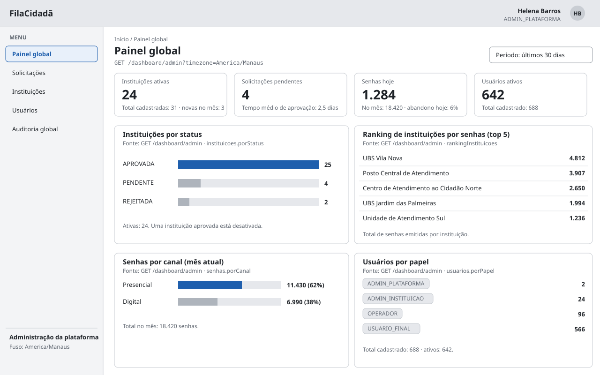
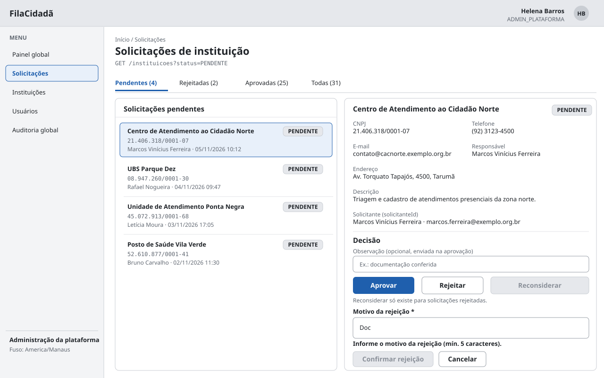
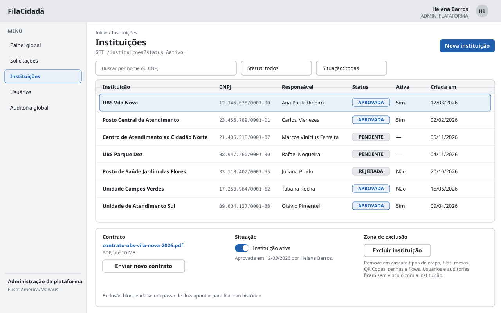
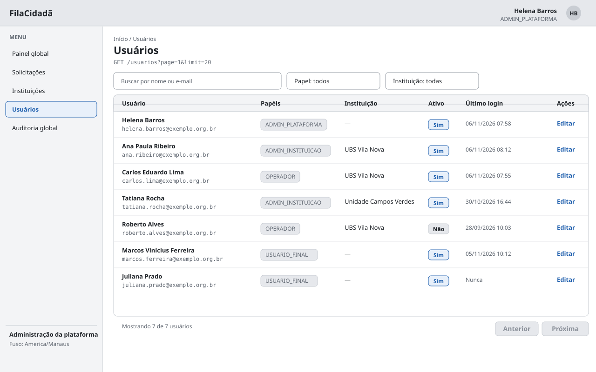
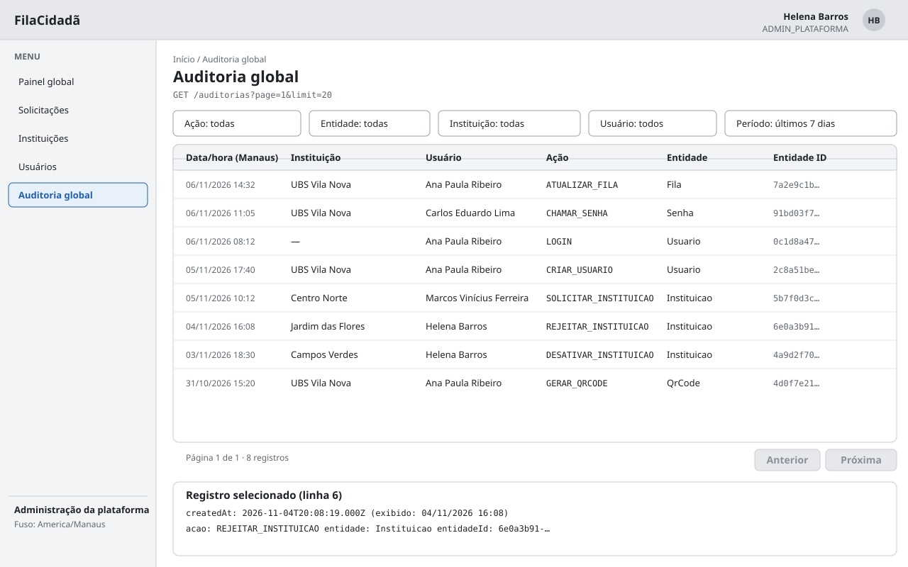
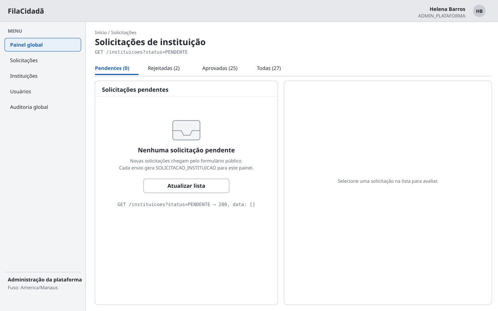
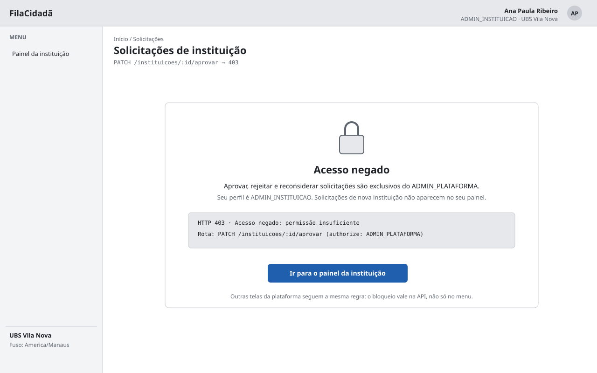

# Wireframes do administrador da plataforma (ADP)

Milestone 2 · Protótipo de interface · Fábrica de Software I

Telas do ator ACT-04 (Administrador da Plataforma, papel `ADMIN_PLATAFORMA`). Desktop 1280 x 800, média fidelidade, tons de cinza com um acento azul. Os campos e as ações seguem as rotas em `src/routes/instituicaoRoutes.js`, `usuarioRoutes.js`, `dashboardRoutes.js` e `auditoriaRoutes.js`, e os schemas de `src/utils/validators/schemas/zod/`.

As US ainda não foram publicadas pela frente de histórias, então a coluna US fica como "pendente". O mapeamento UC para RF também não existe ainda.

## Tabela de telas

| Tela | Arquivo | Ator | UC | US | Estado exibido |
|---|---|---|---|---|---|
| ADP-01 Painel global | [01-dashboard-global.svg](01-dashboard-global.svg) | ACT-04 | UC-13 | pendente | Populado (`GET /dashboard/admin`) |
| ADP-02 Solicitações de instituição | [02-solicitacoes.svg](02-solicitacoes.svg) | ACT-04 | UC-04 (origem em UC-03) | pendente | Populado, com erro de validação do motivo de rejeição |
| ADP-03 Instituições | [03-instituicoes.svg](03-instituicoes.svg) | ACT-04 | sem UC próprio (divergência 6) | pendente | Populado (`GET /instituicoes`) |
| ADP-04 Usuários | [04-usuarios.svg](04-usuarios.svg) | ACT-04 | UC-05 | pendente | Populado (`GET /usuarios`) |
| ADP-05 Auditoria global | [05-auditoria-global.svg](05-auditoria-global.svg) | ACT-04 | UC-14 | pendente | Populado (`GET /auditorias`) |
| ADP-06 Solicitações vazias | [06-solicitacoes-vazia.svg](06-solicitacoes-vazia.svg) | ACT-04 | UC-04 | pendente | Vazio (`data: []`) |
| ADP-07 Acesso negado | [07-estado-sem-permissao.svg](07-estado-sem-permissao.svg) | ACT-03 tentando UC-04 | UC-04 | pendente | Sem permissão (HTTP 403) |

## Estados por perfil

| Perfil | Estado | Tela | Origem no código |
|---|---|---|---|
| ACT-04 Administrador da Plataforma | Vazio | ADP-06 | `GET /instituicoes?status=PENDENTE` responde 200 com `data: []` |
| ACT-03 Administrador da Instituição | Sem permissão | ADP-07 | `authorize(ADMIN_PLATAFORMA)` em `PATCH /instituicoes/:id/aprovar` responde 403 |

## Regras de decisão que as telas refletem

As ações de ADP-02 seguem o status da solicitação, conforme `InstituicaoService`:

| Status | Aprovar | Rejeitar | Reconsiderar |
|---|---|---|---|
| PENDENTE | sim (observação opcional) | sim (motivo com mínimo de 5 caracteres) | não |
| REJEITADA | sim (divergência 1) | não | sim, volta para PENDENTE e limpa o motivo |
| APROVADA | não | não | não |

Desativar e enviar contrato ficam em ADP-03, porque não são decisões de solicitação. Aprovar grava `aprovadoPorId` e `aprovadoEm`. Rejeitar grava `motivoRejeicao`. Os dois geram registro em `auditorias`.

## Telas

### ADP-01 Painel global

### ADP-02 Solicitações de instituição

### ADP-03 Instituições

### ADP-04 Usuários

### ADP-05 Auditoria global

### ADP-06 Solicitações vazias (estado vazio)

### ADP-07 Acesso negado (perfil Administrador da Instituição)

## Divergências

Os itens abaixo estão detalhados, com a fonte, no [README do administrador da instituição](../admin-instituicao/README.md). Os números são os mesmos.

1. Aprovação aceita solicitação rejeitada no código (`InstituicaoService.aprovar`), mas a documentação diz que só `PENDENTE`. ADP-02 segue o código.
2. Transição inválida responde 400 no código e 409 na documentação.
5. Papel `ADMIN_PLATAFORMA` pode ser atribuído sem checagem do ator (risco de escalonamento). Afeta a tela ADP-04 e o formulário de usuário da ADI.
6. Não há UC no catálogo para gerenciar instituições (criar, editar, ativar, contratar e excluir). ADP-03 fica sem UC próprio.

## Veja também

- [Protótipo: visão geral](../../README.md)
- [Mapa do site](../../site-map.md)
- [Wireframes do administrador da instituição](../admin-instituicao/README.md)
- [Histórias de usuário](../../../03-requisitos/historias-de-usuario.md)
- [Requisitos funcionais](../../../03-requisitos/requisitos-funcionais.md)
- [Casos de uso](../../../05-modelagem/casos-de-uso/README.md)
- [Dicionário de dados](../../../06-banco-de-dados/dicionario-de-dados.md)
