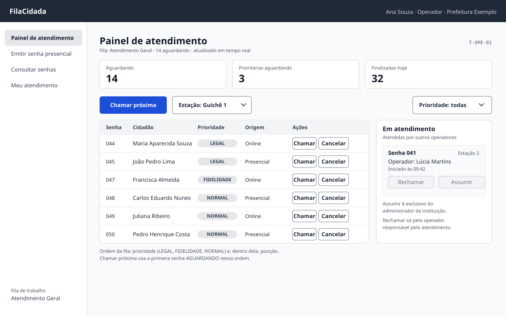
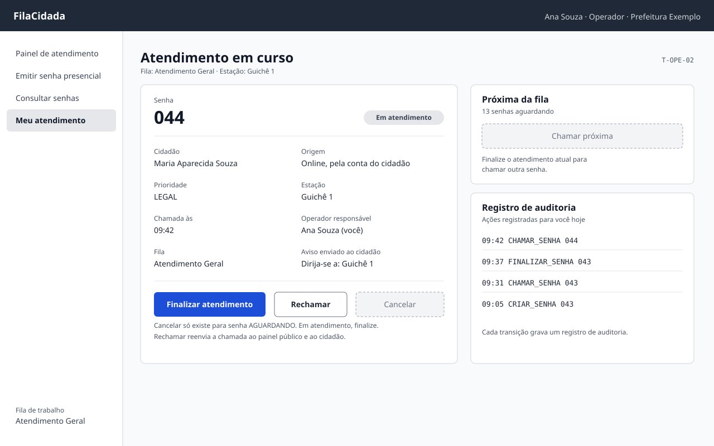
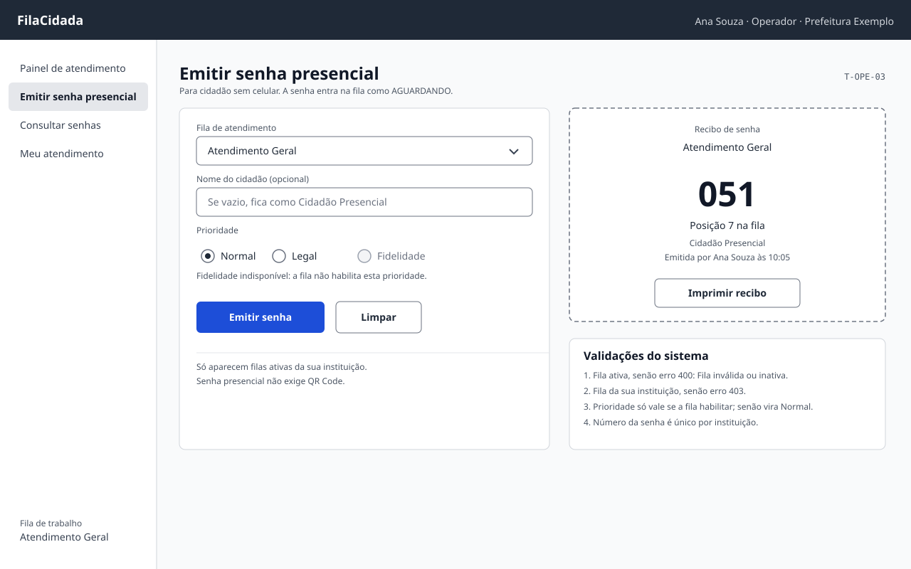
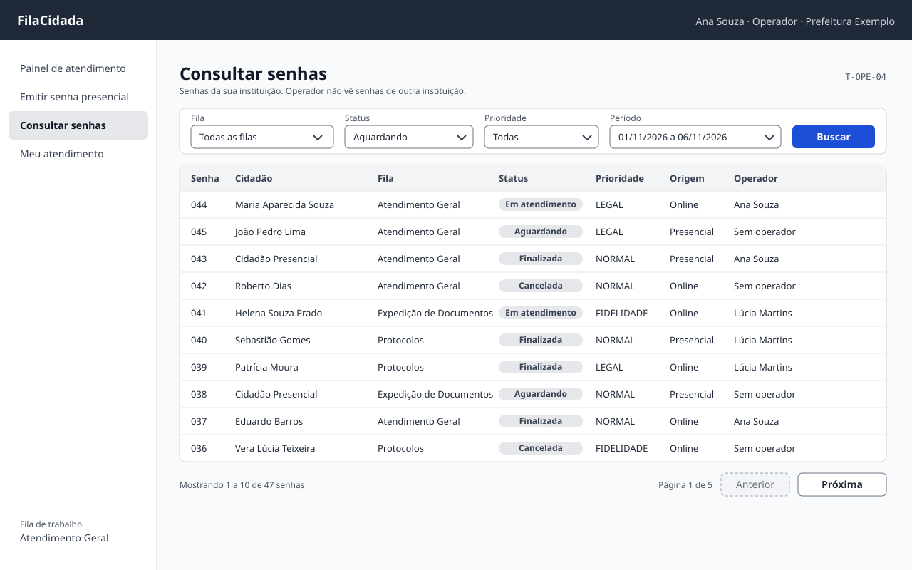
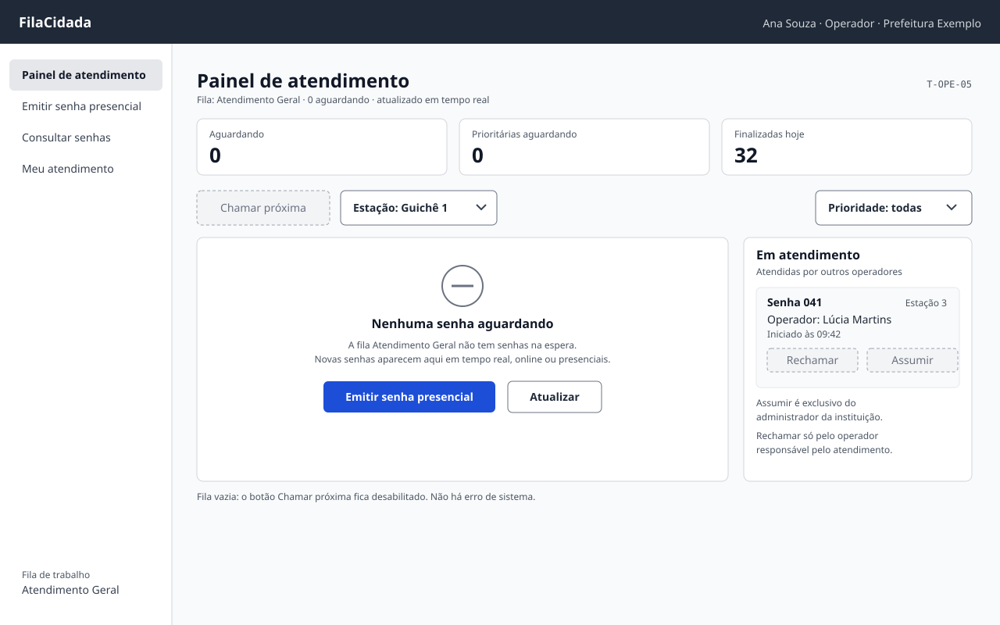
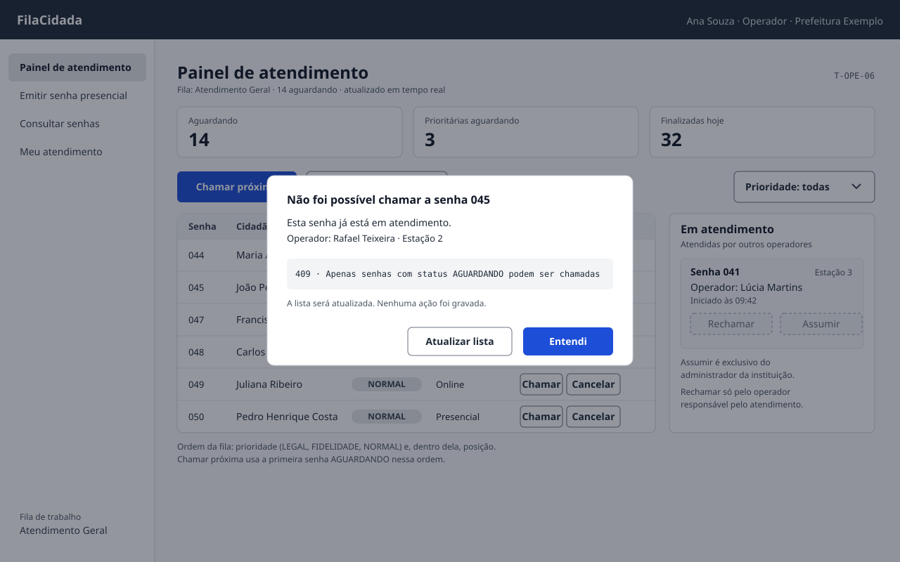
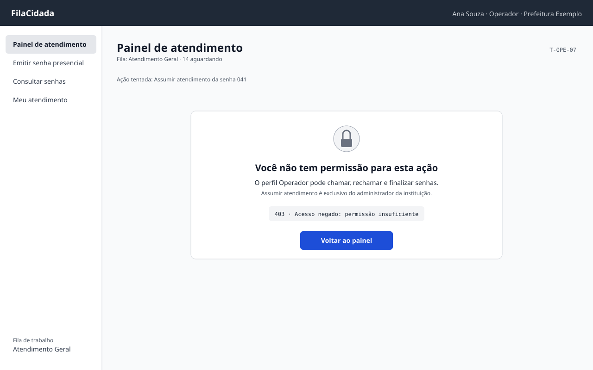

# Wireframes do operador (T-OPE)

Fábrica de Software I · Protótipo em média fidelidade · Desktop 1280x800 · Perfil OPERADOR (ACT-02)

Estes wireframes mostram as telas do operador para atender a fila: painel de atendimento, atendimento em curso, emissão de senha presencial, consulta de senhas e três estados de exceção. As regras de comportamento foram extraídas de `src/services/SenhaService.js`, `src/routes/senhaRoutes.js` e `src/constants/roles.js`. Quando a documentação divergia do código, o código prevaleceu (ver Divergências).

## Telas

| Tela | Arquivo | Caso de uso | US | Ator |
|---|---|---|---|---|
| T-OPE-01 Painel de atendimento | [01-painel-atendimento.svg](01-painel-atendimento.svg) | UC-10 | pendente | ACT-02 |
| T-OPE-02 Atendimento em curso | [02-atendimento-em-curso.svg](02-atendimento-em-curso.svg) | UC-10, UC-11 | pendente | ACT-02 |
| T-OPE-03 Emissão de senha presencial | [03-emissao-senha-presencial.svg](03-emissao-senha-presencial.svg) | UC-09 | pendente | ACT-02 |
| T-OPE-04 Consulta de senhas | [04-consulta-senhas.svg](04-consulta-senhas.svg) | UC-13 (ver Divergências) | pendente | ACT-02 |
| T-OPE-05 Exceção: fila vazia | [05-excecao-fila-vazia.svg](05-excecao-fila-vazia.svg) | UC-10 | pendente | ACT-02 |
| T-OPE-06 Exceção: senha já em atendimento por outro operador | [06-excecao-senha-ja-em-atendimento.svg](06-excecao-senha-ja-em-atendimento.svg) | UC-10 | pendente | ACT-02 |
| T-OPE-07 Exceção: sem permissão | [07-excecao-sem-permissao.svg](07-excecao-sem-permissao.svg) | UC-10 | pendente | ACT-02 |

As histórias de usuário (US) ainda não foram publicadas em `docs/03-requisitos/historias-de-usuario.md`. Quando forem, esta coluna recebe os IDs.

## Painel de atendimento (T-OPE-01)

## Atendimento em curso (T-OPE-02)

## Emissão de senha presencial (T-OPE-03)

## Consulta de senhas (T-OPE-04)

## Exceções (T-OPE-05 a T-OPE-07)

## Regras de comportamento

Estados da senha: AGUARDANDO vai para EM_ATENDIMENTO (chamar) ou CANCELADA (cancelar); EM_ATENDIMENTO vai para FINALIZADA (finalizar). Rechamar e assumir não mudam o estado.

| Ação (rota) | Regra | Resposta de erro | Telas |
|---|---|---|---|
| Chamar (`POST /senhas/:id/chamar`) | Só senha AGUARDANDO. Grava operador, mesa e nome da mesa. Mesa é opcional. | 409 "Apenas senhas com status AGUARDANDO podem ser chamadas" | 01, 06 |
| Chamar | Operador que já atende outra senha não pode chamar. | 409 "Finalize o atendimento atual antes de chamar outra senha" | 02 |
| Chamar | Mesa já ocupada por outro atendimento na mesma fila. | 409 "Estação X já está em uso por outro atendimento" | 01 |
| Chamar | Senha de outra instituição. | 403 | n/a |
| Chamar | Cidadão que já está em atendimento em outra fila da instituição: a senha vai para o fim da fila e o sistema tenta a próxima. Se todas forem puladas, a resposta não é erro (`skipped`, `allSkipped`). | sem erro | n/a |
| Chamar próxima (ação do painel) | Não é endpoint. O painel escolhe a primeira senha AGUARDANDO por `prioridadePeso` (LEGAL 1, FIDELIDADE 2, NORMAL 3) e depois por `posicao`. | n/a | 01, 05 |
| Rechamar (`POST /senhas/:id/rechamar`) | Só senha EM_ATENDIMENTO e só o operador responsável. Reenvia a chamada ao painel público; não gera nova notificação. | 403 "Apenas o operador responsável pode rechamar a senha" | 01, 02 |
| Finalizar (`POST /senhas/:id/finalizar`) | Só senha EM_ATENDIMENTO da mesma instituição. Notifica o cidadão. | 409 "Apenas senhas EM_ATENDIMENTO podem ser finalizadas" | 02 |
| Cancelar (`POST /senhas/:id/cancelar`) | Só senha AGUARDANDO. Permitido ao cidadão dono, ao operador ou admin da mesma instituição, e ao admin da plataforma. | 409 "Senha não pode ser cancelada"; 403 "Sem permissão para cancelar esta senha" | 01, 02 |
| Assumir (`POST /senhas/:id/assumir`) | A rota aceita só ADMIN_INSTITUICAO. Senha EM_ATENDIMENTO. Troca o operador responsável e notifica o anterior. | 403 "Acesso negado: permissão insuficiente" para OPERADOR; 409 "Você já é o operador deste atendimento"; 409 se o admin já atende outra senha | 01, 07 |
| Emitir presencial (`POST /filas/:filaId/senhas/presencial`) | Fila ativa e da mesma instituição. Nome opcional (padrão "Cidadão Presencial"). Prioridade só vale se a fila habilitar (LEGAL exige `prioridadesHabilitadas`; FIDELIDADE exige `fidelidadeHabilitada`); senão vira NORMAL sem erro. Número único por instituição. Não exige QR Code. | 400 "Fila inválida ou inativa"; 403 "Acesso negado: fila pertence a outra instituição" | 03 |
| Consultar (`GET /senhas`) | Operador vê só senhas da própria instituição. Filtros: fila, status, prioridade e período. | n/a | 04 |
| Meu atendimento (`GET /senhas/meu-atendimento`) | Senha EM_ATENDIMENTO do operador, em qualquer fila. | n/a | 02 |

## Estados de exceção

| Estado | Tela | Gatilho | Tratamento na interface |
|---|---|---|---|
| Fila vazia | 05 | Nenhuma senha AGUARDANDO na fila | Chamar próxima desabilitado; estado vazio com ação Emitir senha presencial. Não há erro de API. |
| Senha já em atendimento por outro operador | 06 | Chamada de senha que mudou para EM_ATENDIMENTO após a lista ser carregada | Diálogo com o 409 da API; a lista é atualizada; nada é gravado. |
| Sem permissão | 07 | Operador aciona Assumir, ação exclusiva do administrador da instituição | 403 com mensagem clara. No painel, o botão fica desabilitado com a legenda de quem pode usar. |
| Operador ocupado | 02 | Operador já atende uma senha | Chamar próxima desabilitado com a legenda "Finalize o atendimento atual". |

## Divergências

1. **"Senha já assumida por outro operador" não é erro no código.** Assumir é exclusivo do ADMIN_INSTITUICAO e transfere o atendimento sem conflito. O conflito real é o 409 ao chamar senha que já está EM_ATENDIMENTO, representado na tela 06.
2. **Assumir no painel do operador.** A rota `assumir` exige ADMIN_INSTITUICAO, então OPERADOR recebe 403. A tela 01 mostra o botão desabilitado e a tela 07 mostra a resposta 403. `documentacao/03-papeis-e-regras.md` também atribui a ação só ao administrador da instituição.
3. **UC-11 "finalizar ou cancelar atendimento".** Pelo código, cancelar só vale para senha AGUARDANDO (`SenhaService.cancelar`). Não existe cancelamento de atendimento em curso. A tela 02 mostra Cancelar desabilitado com essa explicação.
4. **Chamar próxima não é endpoint.** `POST /senhas/:id/chamar` recebe o ID da senha, e a API não impede chamar uma senha fora da ordem. A ordem da fila existe só na lógica interna de pular senhas e na escolha feita pelo painel.
5. **Notificação SENHA_PROXIMA.** `documentacao/03-papeis-e-regras.md` diz que chamar notifica o próximo da fila. `SenhaService` não faz isso; `SENHA_PROXIMA` aparece só em seeds. Os wireframes não mostram esse aviso.
6. **Catálogo sem UC para consulta de senhas pelo operador.** A tela T-OPE-04 foi mapeada a UC-13 (dashboard e estatísticas) por falta de caso de uso específico. Vale rever o catálogo.

Veja também:

- [Protótipo](../../README.md)
- [Site map](../../site-map.md)
- [Wireframes do cidadão](../cidadao/README.md)
- [Casos de uso](../../../05-modelagem/casos-de-uso/README.md)
- [Estados](../../../05-modelagem/estados/README.md)
- [Histórias de usuário](../../../03-requisitos/historias-de-usuario.md)
