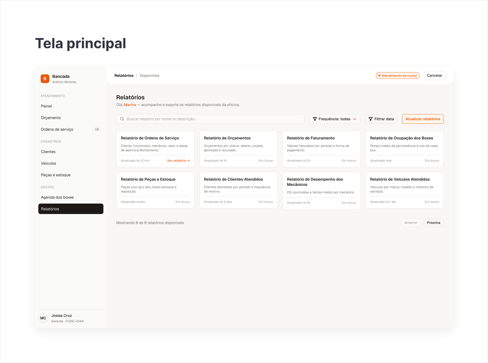

# Wireframes do gerente (T-GER)

Fábrica de Software I · Protótipo em alta fidelidade · Desktop 1440×900 · Perfil Gerente

Estes wireframes mostram a área de relatórios, que o site map atribui ao gerente.

## Telas

| Tela | Arquivo | Caso de uso | US | Área |
|---|---|---|---|---|
| T-GER-01 Relatórios: tela principal | [01-relatorios-tela-principal.svg](01-relatorios-tela-principal.svg) | — | Sem US | Relatórios |

Os casos de uso reproduzem os vínculos registrados nas issues do GitLab, conforme o índice de [historias-de-usuario.md](../../../03-requisitos/historias-de-usuario.md#índice).

A área de Relatórios reúne os relatórios disponíveis da oficina em cartões, com busca e filtros por frequência e data. Pelo site map, é a área do gerente. A área ainda não tem modelo IFML.

## Lista de relatórios

**T-GER-01 · Relatórios · Tela principal**

## Regras de comportamento

Cada linha é um cenário Gherkin das histórias. A coluna Situação indica se o wireframe mostra o comportamento: **Desenhado**, **Parcial** (a tela existe, mas falta parte do cenário), **Não desenhado** ou **Divergente** (a tela contradiz o cenário). Cenários marcados `@proposta` foram escritos pela equipe de documentação e ainda não estão nas issues.

| Cenário | US | Telas | Situação | Observação |
|---|---|---|---|---|
| Relatório da ordem de serviço (RF-07) | Sem US | T-GER-01 | Parcial | O cartão "Relatório de Ordens de Serviço" existe; a tela do relatório, com cliente, funcionário, mecânico, valor total, abertura e fechamento, não foi desenhada |

O RF-07 (relatório da ordem de serviço) e o UC-023 não têm história de usuário; a regra acima vem do texto do requisito.

## Divergências

| ID | Divergência | Telas | Tratamento proposto |
|---|---|---|---|
| W-30 | A tela "Ver informações de um relatório" está no site map, mas não foi desenhada. | — | Desenhar a tela do relatório da OS (SM-01) |
| W-31 | A área de Relatórios não tem história de usuário. | T-GER-01 | Registrar a história a partir do RF-07 (PN-01) |
| W-32 | A tela mostra o menu completo da secretária, embora o site map reserve a área ao gerente. | T-GER-01 | Desenhar o menu do gerente (SM-05) |
| W-33 | A tela foi exportada a partir da seção "10 · Relatórios" do Figma, e não do quadro; por isso o arquivo inclui o rótulo "Tela principal" e tem 1680×1250. | T-GER-01 | Reexportar só o quadro da tela (PN-05; ver R-05 em [Rótulos](../rotulos/README.md)) |

## Veja também

- [Wireframes: todos os perfis](../README.md)
- [Índice das telas](../indice-das-telas.md)
- [Site map](../../site-map.md)
- [Protótipo: revisão de usabilidade e pendências](../../README.md)
- [IFML](../../ifml/README.md)
- [Histórias de usuário](../../../03-requisitos/historias-de-usuario.md)
