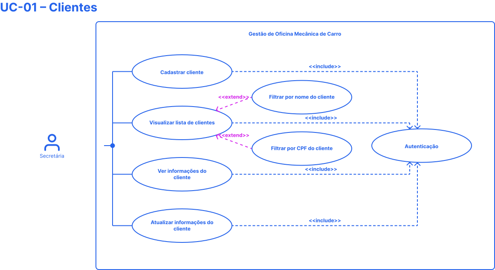
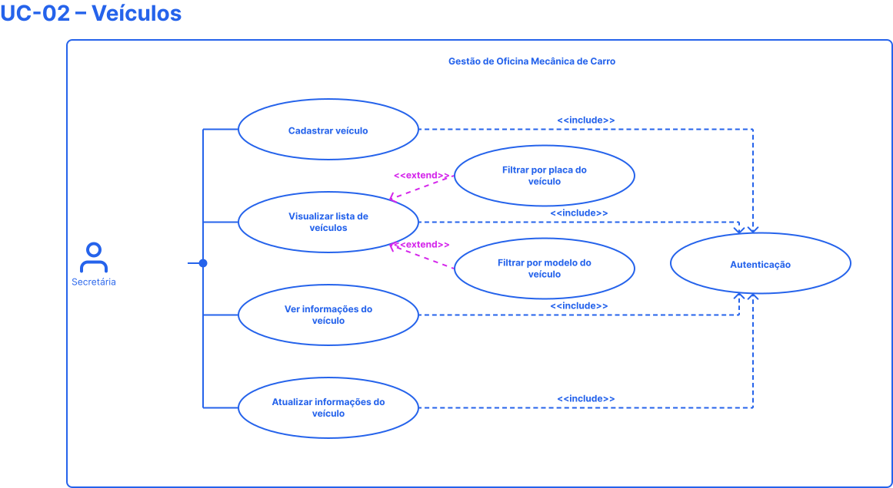
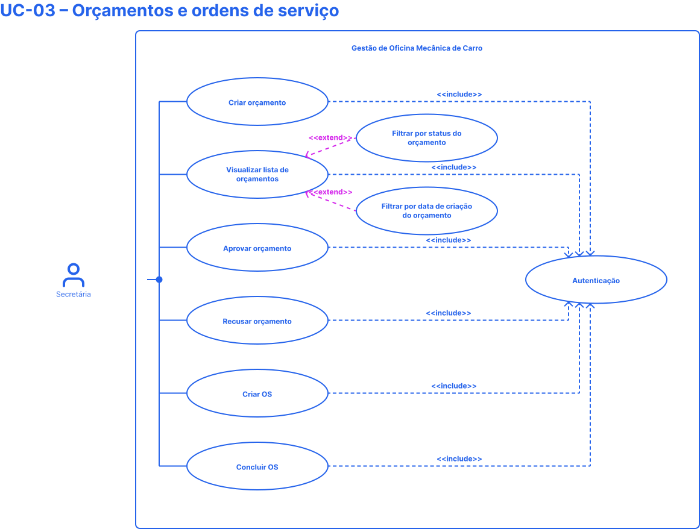
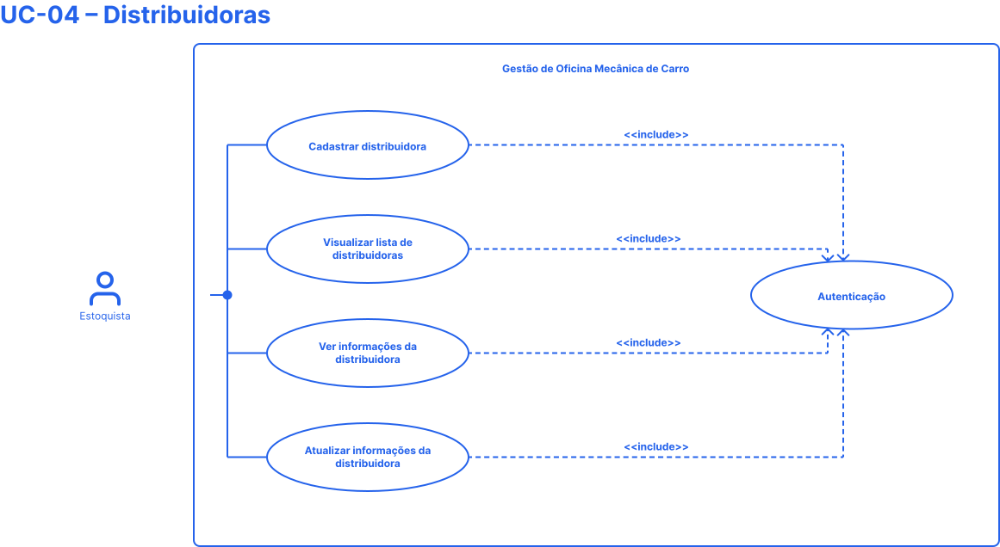
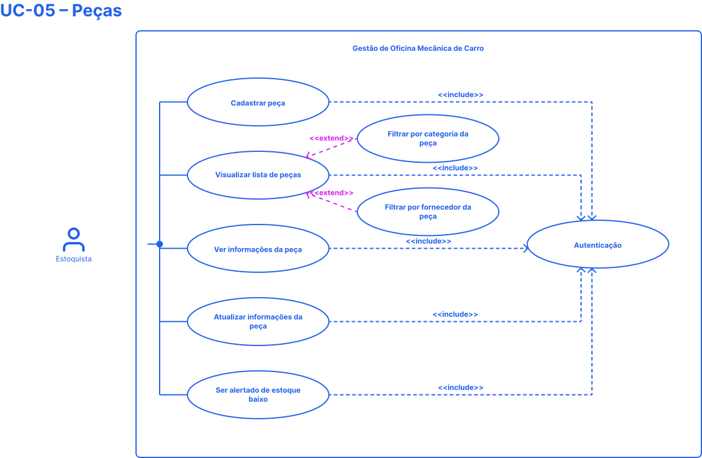

# Casos de uso

Milestone 2 · Modelagem UML (Engenharia de Software, Fábrica de Software I)

Este documento descreve **o que** os atores fazem com o Bancada, o sistema de gestão da oficina mecânica, sem falar de tabelas, telas ou classes. A fronteira do sistema é o próprio Bancada. Cada caso de uso (UC) tem um identificador fixo, o das issues do GitLab (`UC-0YY - US-0XX - <nome>`), usado em todos os artefatos do projeto: requisitos, histórias, diagramas de sequência, de atividades e de estados e matriz de rastreabilidade. O catálogo tem 23 casos de uso, de UC-001 a UC-023.

## Diagrama

O diagrama geral mostra os seis grupos de casos de uso e os atores de cada um. O detalhe de cada grupo está em um diagrama próprio, no arquivo do Figma "Gestão de Oficina Mecânica", página "04 · Diagrama de Casos de Uso". Os diagramas dos grupos não repetem o nome do catálogo: cada um traz o título "UC-01" a "UC-06", que numera o **grupo**, e não o caso de uso. Ver a divergência 2.

### Clientes

### Veículos

### Orçamentos e ordens de serviço

### Distribuidoras

### Peças

### Relatórios

## Atores

| ID | Ator | Vínculo com o sistema | O que faz |
|---|---|---|---|
| ACT-01 | Secretária | Único perfil com login no Milestone 1 | Atende no balcão: cadastra e consulta clientes e veículos, monta e decide orçamentos, abre e conclui OS |
| ACT-02 | Mecânico | Aparece nas histórias; sem login e sem caso de uso próprio | Lança serviços e peças no orçamento (US-016) e é o mecânico designado à OS |
| ACT-03 | Gestor da oficina | Aparece nas histórias; sem login e sem caso de uso próprio | Acompanha o status das OS e o uso dos boxes |
| (sem código) | Estoquista | Aparece nos diagramas e nos casos de uso UC-015 a UC-022 | Cuida das peças e das distribuidoras |
| (sem código) | Gerente | Aparece no diagrama e no UC-023 | Consulta os relatórios |

O Estoquista e o Gerente não constam na lista de atores da [visão do produto](../../01-visao/README.md#partes-interessadas), que prevê só a Secretária com login. A lacuna L-14 de [lacunas.md](../../07-rastreabilidade/lacunas.md) pede a decisão com o cliente sobre os perfis de login. Neste documento, o ator de cada caso de uso é o do diagrama.

## Fronteira do sistema

Dentro da fronteira: autenticação, cadastro de clientes e veículos, orçamentos e sua decisão, ordens de serviço e o ciclo do status, boxes, peças, distribuidoras e a lista de relatórios. Fora do catálogo: o pagamento, que tem tabelas no banco e um cartão de faturamento no protótipo, mas nenhum requisito (lacuna L-16).

## Relações entre casos de uso

**Include (inclusão).** Todos os casos de uso incluem **Autenticar**: só funcionário com login e senha acessa o sistema (RF-01 e US-001). A autenticação é obrigatória e comum a todos, por isso aparece como inclusão e não é repetida nos fluxos. Nos diagramas dos grupos, a ligação aparece em cada caso de uso; no diagrama geral, uma nota registra a regra e a ligação é omitida. Autenticar não tem número no catálogo.

**Extend (extensão).** Um caso de uso estende outro quando o comportamento é opcional e depende de uma condição. No Bancada, os filtros estendem a lista do grupo:

| Filtro (extensão) | Estende | Fonte |
|---|---|---|
| Filtrar por nome do cliente | UC-003 Lista de clientes | US-005 |
| Filtrar por CPF do cliente | UC-003 Lista de clientes | Sem história |
| Filtrar por placa do veículo | UC-008 Lista de veículos | Sem história |
| Filtrar por modelo do veículo | UC-008 Lista de veículos | Sem história |
| Filtrar por status do orçamento | UC-007 Lista de orçamentos | US-026 |
| Filtrar por data de criação do orçamento | UC-007 Lista de orçamentos | Sem história |
| Filtrar por categoria da peça | UC-020 Lista de peças | US-023 |
| Filtrar por fornecedor da peça | UC-020 Lista de peças | US-023 |

Os filtros não têm identificador próprio. A lista de distribuidoras e a de relatórios não têm filtro no diagrama, embora a tela de relatórios tenha busca e filtros por frequência e por data.

A issue do UC-006 (#59) cita também `<<extend>> Criar OS`. O diagrama não desenha essa extensão; a criação da OS aparece como um caso de uso do mesmo grupo (UC-014), que depende do orçamento aprovado (UC-010). Ver a divergência 8.

## Catálogo

Os vínculos com história (US), requisito (RF), diagrama de sequência (DS), de atividades (DA) e de estados (DE) seguem a [matriz de rastreabilidade](../../07-rastreabilidade/matriz.md), o [mapeamento RF → US → UC](../../03-requisitos/requisitos-funcionais.md#mapeamento-rf--us--uc) e os documentos de [sequência](../sequencia/README.md), [atividades](../atividades/README.md) e [estados](../estados/README.md). `US-000` é o código do GitLab para caso de uso sem história vinculada. A coluna Grupo indica o diagrama do Figma.

| UC | Caso de uso | Ator | Grupo | US | RF | DS | DA / DE | Issue |
|---|---|---|---|---|---|---|---|---|
| UC-001 | Cadastro de cliente | Secretária | Clientes | US-003 | RF-01 | DS-001 | DA-001 | [#54](https://gitlab.fslab.dev/fabrica-de-software-i-2026/projeto2/-/issues/54) |
| UC-002 | Atualizar informações do cliente | Secretária | Clientes | US-004 | RF-01 | DS-005 | DA-002 | [#55](https://gitlab.fslab.dev/fabrica-de-software-i-2026/projeto2/-/issues/55) |
| UC-003 | Visualizar lista de clientes cadastrados | Secretária | Clientes | US-010 | RF-01 | DS-009 | DA-008 | [#56](https://gitlab.fslab.dev/fabrica-de-software-i-2026/projeto2/-/issues/56) |
| UC-004 | Cadastro de um veículo | Secretária | Veículos | US-006 | RF-01 | DS-002 | DA-003 | [#57](https://gitlab.fslab.dev/fabrica-de-software-i-2026/projeto2/-/issues/57) |
| UC-005 | Atualizar informações do veículo | Secretária | Veículos | US-007 | RF-01 | DS-006 | DA-006 | [#58](https://gitlab.fslab.dev/fabrica-de-software-i-2026/projeto2/-/issues/58) |
| UC-006 | Cadastrar orçamento | Secretária | Orçamentos e OS | US-016 | RF-02 | DS-003 | DA-004 | [#59](https://gitlab.fslab.dev/fabrica-de-software-i-2026/projeto2/-/issues/59) |
| UC-007 | Visualizar lista de orçamentos feitos | Secretária | Orçamentos e OS | US-000 | RF-02 | DS-016 | DA-013 | [#60](https://gitlab.fslab.dev/fabrica-de-software-i-2026/projeto2/-/issues/60) |
| UC-008 | Visualizar lista de veículos cadastrados | Secretária | Veículos | US-011 | RF-01 | DS-014 | DA-011 | [#61](https://gitlab.fslab.dev/fabrica-de-software-i-2026/projeto2/-/issues/61) |
| UC-009 | Mudar o status do orçamento para recusado | Secretária | Orçamentos e OS | US-028 (GitLab); US-017 | RF-02 | DS-013 | DE-003 | [#62](https://gitlab.fslab.dev/fabrica-de-software-i-2026/projeto2/-/issues/62) |
| UC-010 | Mudar o status do orçamento para aprovado | Secretária | Orçamentos e OS | US-028 (GitLab); US-017 | RF-02 | DS-012 | DE-002 | [#63](https://gitlab.fslab.dev/fabrica-de-software-i-2026/projeto2/-/issues/63) |
| UC-011 | Visualizar perfil do cliente | Secretária | Clientes | US-013 | RF-01 | DS-018 | DA-015 | [#64](https://gitlab.fslab.dev/fabrica-de-software-i-2026/projeto2/-/issues/64) |
| UC-012 | Visualizar informações do veículo | Secretária | Veículos | US-014 | RF-01 | DS-015 | DA-012 | [#65](https://gitlab.fslab.dev/fabrica-de-software-i-2026/projeto2/-/issues/65) |
| UC-013 | Mudar status de uma OS para concluída | Secretária | Orçamentos e OS | US-002 | RF-01, RF-06 | DS-008 | DE-001 | [#66](https://gitlab.fslab.dev/fabrica-de-software-i-2026/projeto2/-/issues/66) |
| UC-014 | Criar OS | Secretária | Orçamentos e OS | US-028 (GitLab); US-008 | RF-06 | DS-004 | DA-005 | [#67](https://gitlab.fslab.dev/fabrica-de-software-i-2026/projeto2/-/issues/67) |
| UC-015 | Cadastrar distribuidora | Estoquista | Distribuidoras | US-000 | RF-05 | DS-010 | DA-009 | [#68](https://gitlab.fslab.dev/fabrica-de-software-i-2026/projeto2/-/issues/68) |
| UC-016 | Atualizar informações da distribuidora | Estoquista | Distribuidoras | US-000 | RF-05 | DS-011 | DA-010 | [#69](https://gitlab.fslab.dev/fabrica-de-software-i-2026/projeto2/-/issues/69) |
| UC-017 | Cadastrar peça | Estoquista | Peças | US-019 | RF-05 | — | — | [#70](https://gitlab.fslab.dev/fabrica-de-software-i-2026/projeto2/-/issues/70) |
| UC-018 | Visualizar lista de distribuidoras | Estoquista | Distribuidoras | US-000 | RF-05 | — | — | [#71](https://gitlab.fslab.dev/fabrica-de-software-i-2026/projeto2/-/issues/71) |
| UC-019 | Visualizar informações da distribuidora | Estoquista | Distribuidoras | US-000 | RF-05 | — | — | [#72](https://gitlab.fslab.dev/fabrica-de-software-i-2026/projeto2/-/issues/72) |
| UC-020 | Visualizar lista de peças | Estoquista | Peças | US-000 | RF-05 | — | — | [#73](https://gitlab.fslab.dev/fabrica-de-software-i-2026/projeto2/-/issues/73) |
| UC-021 | Visualizar informações da peça | Estoquista | Peças | US-020 | RF-05 | — | — | [#74](https://gitlab.fslab.dev/fabrica-de-software-i-2026/projeto2/-/issues/74) |
| UC-022 | Atualizar informações da peça | Estoquista | Peças | US-021 | RF-05 | — | — | [#75](https://gitlab.fslab.dev/fabrica-de-software-i-2026/projeto2/-/issues/75) |
| UC-023 | Visualizar lista de relatórios | Gerente | Relatórios | US-000 | RF-07 | — | — | [#76](https://gitlab.fslab.dev/fabrica-de-software-i-2026/projeto2/-/issues/76) |

Nos UC-009, UC-010 e UC-014, o GitLab vincula a US-028 (status da OS), mas a história correspondente é a US-017 (decisão do cliente sobre o orçamento) nos dois primeiros e a US-008 (cadastro da OS) no último. A divergência 6 trata disso. Os UC-017 a UC-023 ainda não têm diagrama de sequência, de atividades nem de estados.

## Especificação dos casos de uso

Convenções: os passos do fluxo principal são numerados, e cada extensão recebe o número do passo em que se bifurca, seguido de letra (4a, 4b). Todo caso de uso tem como pré-condição a autenticação do ator (`<<include>>` Autenticar), que não é repetida em cada fluxo. As mensagens de erro são as dos diagramas de sequência. Os nomes de status do orçamento são `aberto`, `orçado`, `aprovado` e `recusado`, e os da OS são `aberta`, `em execução` e `concluída`, como no [glossário](../../01-visao/glossario.md).

### Clientes

#### UC-001 Cadastro de cliente

| Campo | Detalhe |
|---|---|
| Ator principal | Secretária |
| Pré-condições | Secretária autenticada. Ela tem as informações e os documentos do cliente |
| Pós-condições | Cliente cadastrado e exibido na lista de clientes |
| US / RF | US-003 / RF-01 |

**Fluxo principal**
1. A Secretária abre "Clientes" no menu e escolhe cadastrar um novo cliente.
2. Informa nome, CPF, data de nascimento, contatos e endereço do cliente e confirma.
3. O Sistema valida os campos obrigatórios e a unicidade de CPF, e-mail e telefone.
4. O Sistema registra o cliente e exibe "cliente cadastrado" e a lista de clientes.

**Extensões**
- **3a.** Campo obrigatório vazio: o cadastro é recusado com "Campo obrigatório não preenchido", e o fluxo volta ao formulário.
- **3b.** CPF, e-mail ou telefone já cadastrado: o cadastro é recusado com "Campo de valor único duplicado", e nenhum cliente novo é criado.

**Regras de negócio**
- O CPF é único (`uk_pessoa_cpf`). O banco também exige e-mail único, data de nascimento e contato preferencial, campos que a US-003 não cita.

#### UC-002 Atualizar informações do cliente

| Campo | Detalhe |
|---|---|
| Ator principal | Secretária |
| Pré-condições | Secretária autenticada. Cliente cadastrado |
| Pós-condições | Informações do cliente atualizadas |
| US / RF | US-004 / RF-01 |

**Fluxo principal**
1. A Secretária abre o cadastro do cliente, a partir da lista ou do perfil, e escolhe editar.
2. Altera as informações desatualizadas e confirma.
3. O Sistema valida os campos obrigatórios.
4. O Sistema confere se CPF, e-mail ou telefone pertencem a outro cliente.
5. O Sistema grava a alteração e exibe a lista de clientes.

**Extensões**
- **3a.** Campo obrigatório vazio: recusado com "Campo obrigatório não preenchido".
- **4a.** CPF, e-mail ou telefone de outro cliente: recusado com "Informação já cadastrada" (a US-004 pede o aviso de conflito de CPF).

**Regras de negócio**
- A atualização não pode gerar CPF duplicado. A tela de edição bloqueia o CPF, então esse conflito só ocorre se a tela passar a aceitá-lo (divergência W-13 do [protótipo](../../04-prototipo/wireframes/secretaria/README.md#divergências)).

#### UC-003 Visualizar lista de clientes cadastrados

| Campo | Detalhe |
|---|---|
| Ator principal | Secretária |
| Pré-condições | Secretária autenticada |
| Pós-condições | Nenhuma. Consulta apenas |
| US / RF | US-010 / RF-01 |

**Fluxo principal**
1. A Secretária clica em "Clientes" no menu.
2. O Sistema lista os clientes cadastrados.
3. A partir de cada cliente, a Secretária pode abrir o perfil (UC-011) ou atualizar as informações (UC-002).

**Extensões**
- **2a (ponto de extensão: lista aberta).** Filtrar por nome ou por CPF do cliente. O diagrama desenha os dois como extensão. Só a busca por nome tem história (US-005).

#### UC-011 Visualizar perfil do cliente

| Campo | Detalhe |
|---|---|
| Ator principal | Secretária |
| Pré-condições | Secretária autenticada. Cliente cadastrado |
| Pós-condições | Nenhuma. Consulta apenas |
| US / RF | US-013 / RF-01 |

**Fluxo principal**
1. Na lista de clientes (UC-003), a Secretária escolhe um cliente.
2. O Sistema exibe as informações do cliente e os carros vinculados a ele.
3. Se necessário, a Secretária segue para a atualização das informações (UC-002).

### Veículos

#### UC-004 Cadastro de um veículo

| Campo | Detalhe |
|---|---|
| Ator principal | Secretária |
| Pré-condições | Secretária autenticada. O cadastro do cliente já foi realizado (UC-001) |
| Pós-condições | Veículo cadastrado e vinculado ao cliente |
| US / RF | US-006 / RF-01 |

**Fluxo principal**
1. A Secretária abre "Veículos" no menu e escolhe cadastrar um novo veículo.
2. Informa placa, marca, modelo, cor e ano do veículo e o CPF do cliente, e confirma.
3. O Sistema valida os campos obrigatórios e a unicidade da placa.
4. O Sistema registra o veículo e exibe "veículo cadastrado" e a lista de veículos.

**Extensões**
- **3a.** Campo obrigatório vazio: recusado com "Campo obrigatório não preenchido".
- **3b.** Placa já cadastrada: recusado com "Campo de valor único duplicado" (a US-006 pede o alerta de placa já cadastrada).

**Regras de negócio**
- A placa é única (`uk_veiculo_placa`), e todo veículo pertence a um cliente.

#### UC-005 Atualizar informações do veículo

| Campo | Detalhe |
|---|---|
| Ator principal | Secretária |
| Pré-condições | Secretária autenticada. Veículo cadastrado |
| Pós-condições | Informações do veículo atualizadas |
| US / RF | US-007 / RF-01 |

**Fluxo principal**
1. A Secretária abre o veículo, a partir da lista ou do detalhe, e escolhe editar.
2. Altera as informações e confirma.
3. O Sistema valida os campos obrigatórios.
4. O Sistema confere se a placa pertence a outro veículo.
5. O Sistema grava a alteração e exibe a lista de veículos.

**Extensões**
- **3a.** Campo obrigatório vazio: recusado com "Campo obrigatório não preenchido".
- **4a.** Placa de outro veículo: recusado com "Informação já cadastrada".

#### UC-008 Visualizar lista de veículos cadastrados

| Campo | Detalhe |
|---|---|
| Ator principal | Secretária |
| Pré-condições | Secretária autenticada |
| Pós-condições | Nenhuma. Consulta apenas |
| US / RF | US-011 / RF-01 |

**Fluxo principal**
1. A Secretária clica em "Veículos" no menu.
2. O Sistema lista os veículos cadastrados.
3. A partir de cada veículo, a Secretária pode ver as informações (UC-012) ou atualizá-las (UC-005).

**Extensões**
- **2a (ponto de extensão: lista aberta).** Filtrar por placa ou por modelo do veículo. Nenhum dos dois filtros tem história.

#### UC-012 Visualizar informações do veículo

| Campo | Detalhe |
|---|---|
| Ator principal | Secretária |
| Pré-condições | Secretária autenticada. Veículo cadastrado |
| Pós-condições | Nenhuma. Consulta apenas |
| US / RF | US-014 / RF-01 |

**Fluxo principal**
1. Na lista de veículos (UC-008), a Secretária escolhe um veículo.
2. O Sistema exibe as informações do veículo.
3. Se necessário, a Secretária segue para a atualização das informações (UC-005).

### Orçamentos e ordens de serviço

#### UC-006 Cadastrar orçamento

| Campo | Detalhe |
|---|---|
| Ator principal | Secretária (a US-016 atribui o lançamento dos serviços e das peças ao Mecânico) |
| Pré-condições | Secretária autenticada. Veículo cadastrado, sem orçamento aberto |
| Pós-condições | Orçamento registrado, com o funcionário e a data e hora. Com os itens lançados, o orçamento fica `orçado` |
| US / RF | US-016 / RF-02 |

**Fluxo principal**
1. A Secretária abre "Orçamentos" e escolhe criar um novo orçamento.
2. Informa os dados do orçamento (placa, quilometragem, valor e forma de pagamento, como no DS-003) e confirma.
3. O Sistema valida os campos obrigatórios e a ausência de orçamento aberto para o veículo.
4. O Sistema registra o orçamento com status `aberto` e exibe "orçamento cadastrado".
5. São lançados os serviços e as peças previstos, cada um com quantidade e valor unitário.
6. O Sistema calcula o total, com a divisão entre peças e mão de obra, e muda o status para `orçado`.

**Extensões**
- **3a.** Campo obrigatório vazio: recusado com "Campo obrigatório não preenchido".
- **3b.** Veículo com orçamento aberto: recusado com "O veículo já tem um orçamento aberto".

**Regras de negócio**
- O ciclo do orçamento é `aberto → orçado → aprovado` ou `recusado`. Cada mudança de status grava o novo status, o funcionário e a data e hora (RF-02).
- O orçamento é montado item a item, com peças e mão de obra separadas (RF-02). O DS-003 não desenha os passos 5 e 6, que vêm da US-016 e das telas T-SEC-28 a T-SEC-30. A tela registra os serviços e um valor fixo, sem lançar as peças (lacuna L-10).

#### UC-007 Visualizar lista de orçamentos feitos

| Campo | Detalhe |
|---|---|
| Ator principal | Secretária |
| Pré-condições | Secretária autenticada |
| Pós-condições | Nenhuma. Consulta apenas |
| US / RF | Sem história (US-000); a US-026 trata do filtro por status / RF-02 |

**Fluxo principal**
1. A Secretária clica em "Orçamentos" no menu.
2. O Sistema lista os orçamentos com o status atual de cada um.
3. A partir de um orçamento, a Secretária pode abrir as informações, aprovar (UC-010) ou recusar (UC-009).

**Extensões**
- **2a (ponto de extensão: lista aberta).** Filtrar por status do orçamento (US-026) ou por data de criação (sem história).

**Regras de negócio**
- A lista não oferece ação de editar nem de remover registros do histórico (US-018).

#### UC-010 Mudar o status do orçamento para aprovado

| Campo | Detalhe |
|---|---|
| Ator principal | Secretária |
| Pré-condições | Secretária autenticada. Orçamento `orçado` |
| Pós-condições | Orçamento `aprovado`, com o funcionário e a data e hora registrados. A OS pode ser criada (UC-014) |
| US / RF | US-017 (o GitLab cita a US-028) / RF-02 |

**Fluxo principal**
1. A Secretária abre o orçamento e registra a aprovação do cliente.
2. O Sistema confere se o orçamento está `orçado`.
3. O Sistema muda o status para `aprovado` e grava o histórico.
4. O Sistema exibe o orçamento com o status atualizado.

**Extensões**
- **2a.** Orçamento `aberto`, `aprovado` ou `recusado`: recusado com "O orçamento não pode ser aprovado nesse status".

**Regras de negócio**
- Nenhum serviço começa sem a aprovação do cliente (RF-02).
- A US-017 pede que a aprovação registre o meio da resposta (presencial, telefone ou mensagem). O DS-012 e as telas ainda não têm esse campo.

#### UC-009 Mudar o status do orçamento para recusado

| Campo | Detalhe |
|---|---|
| Ator principal | Secretária |
| Pré-condições | Secretária autenticada. Orçamento `orçado` |
| Pós-condições | Orçamento `recusado`, com o funcionário e a data e hora registrados. Não gera OS |
| US / RF | US-017 (o GitLab cita a US-028) / RF-02 |

**Fluxo principal**
1. A Secretária abre o orçamento a partir da lista e registra a recusa do cliente.
2. O Sistema confere se o orçamento está `orçado`.
3. O Sistema muda o status para `recusado` e grava o histórico.
4. O Sistema exibe o orçamento com o status atualizado.

**Extensões**
- **2a.** Orçamento `aberto`, `aprovado` ou `recusado`: recusado com "O orçamento não pode ser recusado nesse status".

**Regras de negócio**
- `recusado` é final (DE-003). A US-017 pede o motivo da recusa; o DS-013 e a tela T-SEC-31 não têm esse campo.

#### UC-014 Criar OS

| Campo | Detalhe |
|---|---|
| Ator principal | Secretária |
| Pré-condições | Secretária autenticada. Orçamento `aprovado` (UC-010) |
| Pós-condições | OS criada com status `aberta`, ligada ao orçamento, com o histórico gravado |
| US / RF | US-008 (o GitLab cita a US-028) / RF-06 |

**Fluxo principal**
1. A Secretária seleciona um orçamento aprovado e solicita a criação da OS.
2. O Sistema confere se o orçamento está `aprovado`.
3. O Sistema confere se os dados da OS estão completos.
4. O Sistema registra a OS com status `aberta` e grava o histórico.

**Extensões**
- **2a.** Orçamento não aprovado: o Sistema notifica que o orçamento não foi aprovado e não registra a OS.
- **3a.** Dados incompletos: o Sistema notifica a negação do cadastro e não registra a OS (DA-005).

**Regras de negócio**
- A OS nasce só de um orçamento aprovado, e cada orçamento gera no máximo uma OS (RF-02 e RF-06).
- Para a OS passar a `em execução`, é preciso designar box e mecânico (RF-03 e US-028). A designação e o início da execução ainda não têm caso de uso (ver "Funcionalidades sem caso de uso").
- O DS-004 desenha `iniciarExecucao` em vez do cadastro da OS, e o DA-005 registra a OS como "Aprovada". Ver [sequência](../sequencia/README.md#divergências) e [atividades](../atividades/README.md).

#### UC-013 Mudar status de uma OS para concluída

| Campo | Detalhe |
|---|---|
| Ator principal | Secretária |
| Pré-condições | Secretária autenticada. OS `em execução` |
| Pós-condições | OS `concluída`, com o funcionário e a data e hora de conclusão registrados. O box fica livre |
| US / RF | US-002 e US-028 / RF-01 e RF-06 |

**Fluxo principal**
1. Na tela de atualização da OS (ou na agenda dos boxes), a Secretária conclui o serviço.
2. O Sistema muda o status da OS para `concluída` e grava o histórico.
3. O Sistema libera o box.
4. O Sistema redireciona a Secretária à lista de OS.

**Extensões**
- **1a.** OS que não está `em execução`: a mudança é recusada (a guarda está na [máquina de estados](../estados/README.md), DE-001; o DS-008 não a desenha).

**Regras de negócio**
- O ciclo da OS é `aberta → em execução → concluída` (DE-001).
- A issue do UC-013 diz "quando o carro for retirado", e a US-002 fala em status "retirado" do veículo, que o banco não tem. A retirada ainda não tem estado nem tela própria (divergência 9).

### Distribuidoras

#### UC-015 Cadastrar distribuidora

| Campo | Detalhe |
|---|---|
| Ator principal | Estoquista |
| Pré-condições | Estoquista autenticado |
| Pós-condições | Distribuidora cadastrada e exibida na lista de distribuidoras |
| US / RF | Sem história (US-000) / RF-05 |

**Fluxo principal**
1. O Estoquista abre o cadastro de distribuidora.
2. Informa razão social, CNPJ, telefone, e-mail e endereço (logradouro e bairro) e confirma.
3. O Sistema valida os campos obrigatórios e a unicidade do CNPJ.
4. O Sistema registra a distribuidora e exibe a lista de distribuidoras.

**Extensões**
- **3a.** Campo obrigatório em branco: recusado com "Campo obrigatório não preenchido".
- **3b.** CNPJ já cadastrado: recusado com "CNPJ já cadastrado". A tela T-EST-14 mostra também telefone e e-mail já cadastrados.

**Regras de negócio**
- A distribuidora é o fornecedor da peça (RF-05). Nenhuma história trata dela (lacuna L-17).

#### UC-016 Atualizar informações da distribuidora

| Campo | Detalhe |
|---|---|
| Ator principal | Estoquista |
| Pré-condições | Estoquista autenticado. Distribuidora cadastrada |
| Pós-condições | Informações da distribuidora atualizadas |
| US / RF | Sem história (US-000) / RF-05 |

**Fluxo principal**
1. O Estoquista abre a distribuidora e escolhe editar o cadastro.
2. Altera as informações e salva.
3. O Sistema valida os campos obrigatórios.
4. O Sistema confere se o CNPJ pertence a outra distribuidora.
5. O Sistema grava a alteração e exibe as informações atualizadas.

**Extensões**
- **3a.** Campo obrigatório em branco: recusado com "Campo obrigatório não preenchido".
- **4a.** CNPJ de outra distribuidora: recusado com "CNPJ já cadastrado".

#### UC-018 Visualizar lista de distribuidoras

| Campo | Detalhe |
|---|---|
| Ator principal | Estoquista |
| Pré-condições | Estoquista autenticado |
| Pós-condições | Nenhuma. Consulta apenas |
| US / RF | Sem história (US-000) / RF-05 |

**Fluxo principal**
1. O Estoquista abre a lista de distribuidoras.
2. O Sistema mostra cada distribuidora, com o contato e a data do último pedido (T-EST-12).
3. A partir da lista, o Estoquista pode buscar, abrir as informações (UC-019) ou cadastrar uma nova distribuidora (UC-015).

#### UC-019 Visualizar informações da distribuidora

| Campo | Detalhe |
|---|---|
| Ator principal | Estoquista |
| Pré-condições | Estoquista autenticado. Distribuidora cadastrada |
| Pós-condições | Nenhuma. Consulta apenas |
| US / RF | Sem história (US-000) / RF-05 |

**Fluxo principal**
1. Na lista de distribuidoras (UC-018), o Estoquista escolhe uma distribuidora.
2. O Sistema exibe a identificação, o contato e o endereço (T-EST-16).
3. Se necessário, o Estoquista segue para a atualização do cadastro (UC-016) ou contata a distribuidora.

### Peças

#### UC-017 Cadastrar peça

| Campo | Detalhe |
|---|---|
| Ator principal | Estoquista |
| Pré-condições | Estoquista autenticado |
| Pós-condições | Peça cadastrada no estoque e exibida na lista de peças |
| US / RF | US-019 / RF-05 |

**Fluxo principal**
1. O Estoquista abre o cadastro de peça.
2. Informa nome, código, categoria, quantidade, valor unitário e fornecedor e confirma.
3. O Sistema valida o código e a quantidade.
4. O Sistema registra a peça e a exibe na lista de peças.

**Extensões**
- **3a.** Código já cadastrado: recusado, com o aviso de código já cadastrado.
- **3b.** Quantidade menor que zero: recusado, com o aviso de que a quantidade não pode ser negativa.

**Regras de negócio**
- O código é único (`uk_peca_codigo`), e a quantidade nunca é negativa (`ck_peca_estoque`).
- Os cenários da US-019 são `@proposta`, e a tela T-EST-04 ainda está no modelo anterior (W-20 do [protótipo](../../04-prototipo/wireframes/estoquista/README.md)).

#### UC-020 Visualizar lista de peças

| Campo | Detalhe |
|---|---|
| Ator principal | Estoquista |
| Pré-condições | Estoquista autenticado |
| Pós-condições | Nenhuma. Consulta apenas |
| US / RF | Sem história no GitLab (US-000); a US-023 trata da busca e dos filtros / RF-05 |

**Fluxo principal**
1. O Estoquista abre "Peças e estoque".
2. O Sistema lista as peças, com código, nome, categoria, fornecedor, quantidade, estoque mínimo, valor unitário e situação (disponível, estoque baixo ou esgotado).
3. A partir de uma peça, o Estoquista pode ver as informações (UC-021) ou cadastrar uma nova peça (UC-017).

**Extensões**
- **2a (ponto de extensão: lista aberta).** Buscar por nome ou código e filtrar por categoria ou por fornecedor (US-023).
- **2b.** Busca ou filtro sem resultado: o Sistema mostra "Nenhuma peça encontrada" (T-EST-03).

#### UC-021 Visualizar informações da peça

| Campo | Detalhe |
|---|---|
| Ator principal | Estoquista (a US-020 cita o funcionário de atendimento) |
| Pré-condições | Estoquista autenticado. Peça cadastrada |
| Pós-condições | Nenhuma. Consulta apenas |
| US / RF | US-020 / RF-05 |

**Fluxo principal**
1. Na lista de peças (UC-020), o Estoquista escolhe uma peça.
2. O Sistema exibe nome, código, categoria, quantidade, estoque mínimo, valor unitário e fornecedor, e o histórico de alterações da peça.
3. Se a quantidade estiver abaixo do mínimo, o Sistema mostra o aviso de estoque baixo.
4. Se necessário, o Estoquista segue para a edição (UC-022).

**Regras de negócio**
- A tela T-EST-06 também oferece "Excluir peça", que não tem caso de uso (US-022).
- O histórico de alterações da peça não tem classe nem tabela (lacuna L-07).

#### UC-022 Atualizar informações da peça

| Campo | Detalhe |
|---|---|
| Ator principal | Estoquista (a US-021 cita o funcionário de atendimento) |
| Pré-condições | Estoquista autenticado. Peça cadastrada |
| Pós-condições | Peça atualizada, com o histórico registrando o valor anterior, o novo, o funcionário e a data e hora |
| US / RF | US-021 / RF-05 |

**Fluxo principal**
1. O Estoquista abre a peça e escolhe editar.
2. Altera os dados (por exemplo, o valor unitário) e confirma.
3. O Sistema confere se o código pertence a outra peça.
4. O Sistema grava a alteração e registra o histórico.
5. O Sistema confirma "Peça atualizada com sucesso" e oferece voltar ao estoque ou ver os detalhes.

**Extensões**
- **3a.** Código de outra peça: a alteração é recusada, com o aviso de código já cadastrado.

**Regras de negócio**
- Os cenários da US-021 são `@proposta`. A edição preserva o histórico da peça.

### Relatórios

#### UC-023 Visualizar lista de relatórios

| Campo | Detalhe |
|---|---|
| Ator principal | Gerente |
| Pré-condições | Gerente autenticado |
| Pós-condições | Nenhuma. Consulta apenas |
| US / RF | Sem história (US-000) / RF-07 |

**Fluxo principal**
1. O Gerente abre "Relatórios".
2. O Sistema mostra os relatórios disponíveis em cartões, com busca e filtros por frequência e por data (T-GER-01).
3. O Gerente escolhe o relatório da ordem de serviço.
4. O Sistema exibe, para cada OS, o nome do cliente, do funcionário e do mecânico, o orçamento ou valor total e as datas de abertura e de fechamento (RF-07).

**Regras de negócio**
- A tela do relatório da OS (passos 3 e 4) não foi desenhada (W-30). A tela principal traz oito cartões, e o RF-07 trata só do relatório da OS (lacuna L-16).

## Funcionalidades sem caso de uso

Catorze das 30 histórias não têm caso de uso no catálogo, e as outras 16 têm (lacuna L-01 de [lacunas.md](../../07-rastreabilidade/lacunas.md)). A lista abaixo é a da [matriz de rastreabilidade](../../07-rastreabilidade/matriz.md#cobertura-da-cadeia), com uma história por linha. O diagrama de peças desenha "Ser alertado de estoque baixo", que não existe no catálogo.

| Funcionalidade | Origem | Situação no diagrama |
|---|---|---|
| Autenticação da secretária | US-001 | Só como `<<include>>` |
| Busca de clientes | US-005 | Desenhado como extensão do UC-003 |
| Atualização da OS | US-009 | Sem caso de uso |
| Listagem de OS | US-012 | Sem caso de uso; tem o DS-017 (`UC-000`) |
| Visualização das informações de uma OS | US-015 | Sem caso de uso; tem o DS-020 (`UC-000`) |
| Histórico de status do orçamento | US-018 | Sem caso de uso |
| Exclusão de peça | US-022 | Sem caso de uso |
| Busca e filtros de peças | US-023 | Desenhado como extensão do UC-020 |
| Alerta de estoque baixo | US-024 | Desenhado ("Ser alertado de estoque baixo"), sem UC |
| Filtro de orçamentos por status | US-026 | Desenhado como extensão do UC-007 |
| Histórico de status da OS | US-027 | Sem caso de uso |
| Histórico do veículo por placa | US-029 | Sem caso de uso |
| Orientação inicial na tela de histórico do veículo | US-030 | Sem caso de uso |
| Agenda dos boxes, designação de box e mecânico | #42 (RF-03) | Sem caso de uso |

Três histórias não estão na lista porque têm caso de uso pelo vínculo da modelagem: a US-002 (UC-013), a US-008 (UC-014) e a US-017 (UC-009 e UC-010). O registro de retirada do veículo, da US-002, não tem caso de uso próprio (divergência 9). Nos UC-009, UC-010 e UC-014, o título da issue no GitLab cita a US-028 (divergência 6).

## Divergências

Diferenças entre os diagramas, o catálogo do GitLab e as demais fontes do projeto. Onde há diferença, a issue do GitLab e a decisão do grupo registrada nos requisitos prevalecem. Nada foi corrigido nos diagramas: os itens são para decisão do grupo.

1. **Atores fora do catálogo (L-14).** Os diagramas usam Estoquista e Gerente, que não têm código de ator. A visão do produto lista Secretária (ACT-01), Mecânico (ACT-02) e Gestor da oficina (ACT-03) e diz que a Secretária é o único perfil com login. Falta decidir os perfis com o cliente e, depois, dar código aos atores e alinhar telas e histórias. O Gerente do diagrama pode corresponder ao Gestor da oficina (ACT-03); isso precisa de confirmação.
2. **Dois usos de "UC-0N".** Os diagramas dos grupos são titulados "UC-01" a "UC-06", e o catálogo usa "UC-001" a "UC-023". A diferença de um zero faz o título de um grupo parecer um caso de uso do catálogo. Sugestão: renomear os quadros para "Diagrama 1 · Clientes" e assim por diante.
3. **Nomes diferentes entre diagrama e catálogo.** O diagrama usa "Cadastrar cliente", "Ver informações do cliente", "Atualizar informações do veículo", "Criar orçamento", "Aprovar orçamento", "Recusar orçamento", "Concluir OS" e "Visualizar lista de relatórios"; o catálogo usa "Cadastro de cliente", "Visualizar perfil do cliente", "Atualizar informações do veículo", "Cadastrar orçamento", "Mudar o status do orçamento para aprovado", "Mudar o status do orçamento para recusado" e "Mudar status de uma OS para concluída". O diagrama também escreve "Autenticação" onde o catálogo diz "Autenticar". A tabela do catálogo usa os nomes do GitLab.
4. **Caso de uso desenhado e fora do catálogo.** "Ser alertado de estoque baixo" aparece no diagrama de peças, mas não tem UC. A história é a US-024.
5. **Histórias sem caso de uso (L-01) e casos de uso sem história.** Catorze das 30 histórias não têm caso de uso (seção anterior). Sete casos de uso têm `US-000`: UC-007, UC-015, UC-016, UC-018, UC-019, UC-020 e UC-023. Nos UC-007 e UC-020, a história existe (US-026 e US-023), mas o título da issue não a cita.
6. **Vínculos UC → US incorretos (L-02).** UC-009, UC-010 e UC-014 citam a US-028, que trata do status da OS. A história correta é a US-017 nos dois primeiros e a US-008 no UC-014. A correção é no título das issues #62, #63 e #67.
7. **Atores das histórias.** A US-016 atribui o orçamento ao Mecânico, e a issue do UC-006 e o diagrama atribuem a Secretária. As US-020 e US-021 falam em funcionário de atendimento, e os casos de uso UC-021 e UC-022 usam o Estoquista.
8. **`<<extend>> Criar OS` no UC-006.** A issue #59 cita a extensão, e o diagrama não a desenha. Como a OS depende do orçamento aprovado (UC-010), a ligação correta parece ser entre o UC-010 e o UC-014, e não uma extensão do UC-006. Decisão do grupo.
9. **Sentido do UC-013.** O catálogo diz "concluída", a issue acrescenta "quando o carro for retirado", e a US-002 fala em status "retirado" do veículo, que o banco não tem. A OS termina em `concluída` (DE-001), e a retirada não tem estado nem tela própria (W-04 do protótipo).
10. **Filtros sem história.** Quatro dos oito filtros do diagrama não têm história (CPF, placa, modelo e data de criação do orçamento); os outros quatro têm: nome (US-005), status do orçamento (US-026) e categoria e fornecedor da peça (US-023). A [matriz](../../07-rastreabilidade/matriz.md) aceita os filtros como extensão de casos de uso existentes.
11. **Casos de uso sem diagrama de sequência (L-03).** UC-017 a UC-023 não têm DS, DA nem DE. Os DS-007, DS-017, DS-019 e DS-020 têm `UC-000`, isto é, não têm caso de uso no catálogo.
12. **Cadastro da OS e status inicial.** O UC-014 usa o fluxo da issue #81 (OS criada a partir do orçamento aprovado), mas o DS-004 desenha `iniciarExecucao` e o DA-005 registra a OS como "Aprovada", enquanto o ciclo do grupo é `aberta → em execução → concluída` (lacuna L-11).

## Veja também

- [Visão geral da modelagem](../README.md)
- [Sequência](../sequencia/README.md)
- [Atividades](../atividades/README.md)
- [Estados](../estados/README.md)
- [Classes](../classes/README.md)
- [Requisitos funcionais](../../03-requisitos/requisitos-funcionais.md)
- [Histórias de usuário](../../03-requisitos/historias-de-usuario.md)
- [Matriz de rastreabilidade](../../07-rastreabilidade/matriz.md)
- [Lacunas](../../07-rastreabilidade/lacunas.md)
- [Glossário](../../01-visao/glossario.md)
