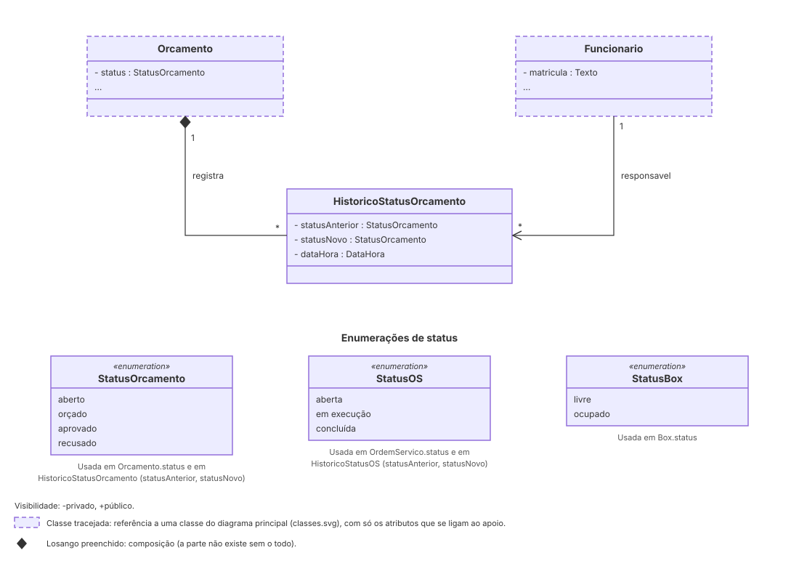

# Diagrama de classes de domínio

Milestone 2 · Modelagem do domínio (Fábrica de Software I)

O diagrama modela o domínio do Bancada, o sistema de gestão da oficina mecânica: as classes que o negócio reconhece, seus atributos, operações e associações. Não é diagrama de tabelas, de telas ou de repositórios. O glossário do projeto traz a tabela de cada termo ([glossario.md](../../01-visao/glossario.md)). O [dicionário de dados](../../06-banco-de-dados/dicionario-de-dados.md) ainda é o do FilaCidadã e não serve de fonte (ver divergências).

## Arquivos

- [classes.svg](classes.svg): diagrama principal, com as 19 classes do domínio: pessoas (`Pessoa`, `Cliente`, `Funcionario`, `Funcao`, `Endereco`), veículo (`Veiculo`, `CarroMarca`, `CarroModelo`), orçamento e OS (`Orcamento`, `ItemOrcamentoPeca`, `ItemOrcamentoServico`, `Servico`, `OrdemServico`, `Box`, `HistoricoStatusOS`) e estoque (`Peca`, `Distribuidora`, `PecaDistribuidora`, `Compatibilidade`).
- [classes-apoio.svg](classes-apoio.svg): diagrama de apoio, com a classe `HistoricoStatusOrcamento` e as enumerações de status (`StatusOrcamento`, `StatusOS` e `StatusBox`). `Orcamento` e `Funcionario` aparecem tracejadas, como referência ao diagrama principal.

Os tipos dos atributos são `Texto`, `Inteiro`, `Decimal`, `Data`, `DataHora`, `Hora` e `Booleano`, além das enumerações de status. Visibilidade: `-` é privado e `+` é público.

## Lista oficial de classes

Nomes oficiais, em português, no singular e sem acento. Sequência, estados e OCL usam estes mesmos nomes. As telas são citadas por perfil (Secretária, Estoquista e Gerente); os nomes finais dos quadros estão em [04-prototipo](../../04-prototipo/README.md). A coluna Tabela segue o [glossário](../../01-visao/glossario.md).

| Classe | Responsabilidade | Telas (perfil) | Tabela |
|---|---|---|---|
| Pessoa | Classe abstrata com os dados comuns de quem se relaciona com a oficina: nome, CPF, nascimento, contatos e observações. É especializada por `Cliente` e `Funcionario`. | Secretária: login, cadastros, listagens, atualizações e visualizações. Estoquista: as mesmas telas do estoque. Gerente: visualizações | `pessoa` |
| Endereco | Localização de uma pessoa ou de uma distribuidora (CEP, logradouro, bairro, cidade e UF). | Secretária e Estoquista: cadastro, listagem, atualização e visualização | A confirmar no DDL |
| Cliente | Pessoa que traz o veículo para a oficina, é dona dele e aprova ou recusa o orçamento. | Secretária: cadastro, listagem, atualização e visualização | `pessoa`, ligada ao veículo por `veiculo.pess_id` |
| Funcionario | Pessoa que trabalha na oficina, com matrícula, senha e horário. Autentica-se no sistema, elabora orçamentos e é o mecânico designado à OS. | Login | `funcionario` |
| Funcao | Cargo do funcionário (secretária, mecânico). Também define o nível de acesso ao sistema. | Cabeçalho do sistema | `funcao` |
| Veiculo | Veículo do cliente, identificado pela placa. Recebe orçamentos. | Secretária: cadastro, listagem, atualização e visualização | `veiculo` |
| CarroMarca | Marca do veículo. Agrupa os modelos. | Secretária: seleção | `carro_marca` |
| CarroModelo | Modelo do veículo, com o período de fabricação. Também liga a peça aos modelos compatíveis. | Secretária: seleção | `carro_modelo` |
| Orcamento | Proposta de serviço para um veículo, montada item a item. Passa por `aberto` e `orçado` e termina em `aprovado` ou `recusado`. Gera no máximo uma OS. | Secretária: cadastro, listagem, atualização e visualização | `orcamento` |
| ItemOrcamentoPeca | Classe associativa que vincula uma peça ao orçamento, com quantidade e valor unitário. | Secretária: montagem do orçamento | `orcamento_peca` |
| ItemOrcamentoServico | Classe associativa que vincula um serviço (mão de obra) ao orçamento, com quantidade e valor unitário. | Secretária: montagem do orçamento | `orcamento_servico` |
| Servico | Tipo de serviço (mão de obra) cobrado no orçamento, com descrição e valor. | Secretária: seleção | `servico` |
| OrdemServico | Serviço autorizado, criado a partir de um orçamento aprovado. Passa por `aberta`, `em execução` e `concluída`, e é designada a um box e a um mecânico. | Secretária: cadastro, listagem, atualização e visualização | `ordem_servico` |
| Box | Espaço da oficina onde um veículo é atendido, um de cada vez. Tem as operações `ocupar` e `liberar`. | Secretária: agenda dos boxes e designação | `box` |
| HistoricoStatusOS | Registra cada mudança de status da OS, com o status anterior, o novo, a data e hora e o funcionário responsável. | Gerente: relatório | `ordem_servico_historico` |
| HistoricoStatusOrcamento | Registra cada mudança de status do orçamento, nos mesmos moldes de `HistoricoStatusOS`. Desenhada no diagrama de apoio. | Secretária: tela inicial de Orçamentos (US-018) | `orcamento_historico` |
| Peca | Item do estoque, com código, preço, quantidade e estoque mínimo. Compõe o orçamento e avisa quando o estoque está baixo. | Estoquista: cadastro, listagem, atualização e visualização. Secretária: seleção | `peca` |
| Distribuidora | Fornecedor que vende peças à oficina. | Estoquista: cadastro, listagem, atualização e visualização | `distribuidora` |
| PecaDistribuidora | Classe associativa entre peça e distribuidora, com preço de custo e data da cotação. | Estoquista: seleção | `peca_distribuidora` |
| Compatibilidade | Classe associativa entre peça e modelo do carro, com observação. | Estoquista: visualização. Secretária: seleção | `peca_modelo` |

## Associações e multiplicidades

Leitura: o número junto a uma classe indica quantas instâncias dela se ligam a uma instância da outra. Losango preenchido indica composição, losango vazado indica agregação, e triângulo vazado indica herança.

| Associação | Multiplicidade (A e B) | Tipo | Observação |
|---|---|---|---|
| Pessoa e Cliente | Não se aplica | Herança | `Cliente` especializa `Pessoa` |
| Pessoa e Funcionario | Não se aplica | Herança | `Funcionario` especializa `Pessoa` |
| Pessoa e Endereco | 0..1 e 1 | Composição | O endereço pertence à pessoa |
| Distribuidora e Endereco | 0..1 e 1 | Composição | O endereço pertence à distribuidora |
| Funcionario e Funcao | * e 1 | Associação | `exerce`: cada funcionário tem uma função |
| Cliente e Veiculo | 1 e * | Agregação | `possui`: o veículo existe sem o cliente no sistema |
| CarroMarca e CarroModelo | 1 e * | Associação | `tem` |
| CarroModelo e Veiculo | 1 e * | Associação | `classifica` |
| Veiculo e Orcamento | 1 e * | Associação | `recebe`: um veículo pode ter vários orçamentos |
| Funcionario e Orcamento | 1 e * | Associação | `elabora` |
| Orcamento e ItemOrcamentoPeca | 1 e * | Composição | Peças do orçamento |
| Orcamento e ItemOrcamentoServico | 1 e * | Composição | Mão de obra do orçamento |
| Peca e ItemOrcamentoPeca | 1 e * | Associação | |
| Servico e ItemOrcamentoServico | 1 e * | Associação | |
| Orcamento e OrdemServico | 1 e 0..1 | Associação | `gera`: cada orçamento gera no máximo uma OS, e só se for aprovado |
| OrdemServico e Box | * e 0..1 | Associação | `ocupa`: o box só é definido na designação |
| OrdemServico e Funcionario | * e 0..1 | Associação | `mecanico`: definido na designação |
| OrdemServico e HistoricoStatusOS | 1 e * | Composição | `registra` |
| Funcionario e HistoricoStatusOS | 1 e * | Associação | `responsavel` |
| Orcamento e HistoricoStatusOrcamento | 1 e * | Composição | `registra`. Diagrama de apoio |
| Funcionario e HistoricoStatusOrcamento | 1 e * | Associação | `responsavel`. Diagrama de apoio |
| Peca e PecaDistribuidora | 1 e * | Associação | |
| Distribuidora e PecaDistribuidora | 1 e * | Associação | `fornece` |
| Peca e Compatibilidade | 1 e * | Associação | |
| CarroModelo e Compatibilidade | 1 e * | Associação | |

## Enumerações

| Enumeração | Literais | Usada em |
|---|---|---|
| StatusOrcamento | aberto, orçado, aprovado, recusado | `Orcamento.status`; `HistoricoStatusOrcamento.statusAnterior` e `statusNovo` |
| StatusOS | aberta, em execução, concluída | `OrdemServico.status`; `HistoricoStatusOS.statusAnterior` e `statusNovo` |
| StatusBox | livre, ocupado | `Box.status` |

Os literais de `StatusOrcamento` e `StatusOS` são os valores gravados no banco (`ck_orca_status` e `ck_os_status`). As transições entre eles estão em [Máquinas de estados](../estados/README.md). Os literais de `StatusBox` precisam de confirmação (ver divergências).

## Decisões de modelagem

- **Pessoa abstrata, com duas especializações.** `Cliente` e `Funcionario` herdam os dados de `Pessoa`, como no banco, em que o cliente é uma pessoa ligada ao veículo e o funcionário é uma pessoa com cadastro de funcionário. Quem tem login é só o funcionário.
- **Orçamento item a item.** As peças e a mão de obra entram como itens separados (`ItemOrcamentoPeca` e `ItemOrcamentoServico`), em composição com o orçamento, como pede a RF-02. `Orcamento.calcularTotal()` soma os itens.
- **Orçamento e OS são classes distintas.** A OS nasce de um orçamento aprovado e cada orçamento gera no máximo uma OS (multiplicidade 0..1). Os status de decisão do cliente (`aprovado` e `recusado`) pertencem ao orçamento, e o ciclo da OS é `aberta → em execução → concluída`.
- **Status como enumeração.** Os atributos `status` usam `StatusOrcamento`, `StatusOS` e `StatusBox`, que ficam no diagrama de apoio. As transições e as guardas são dos diagramas de estados.
- **Histórico como classe de registro.** Cada mudança de status gera um registro ligado ao orçamento ou à OS, com o funcionário responsável e a data e hora (RF-02 e RF-06). O registro não tem ciclo de vida próprio, por isso não tem máquina de estados.
- **Operações de domínio, não de tela.** As operações correspondem a regras e a diagramas já feitos: `Orcamento.aprovar` e `recusar` (DS-012 e DS-013), `OrdemServico.designarBox`, `iniciar` e `concluir` (RF-03 e DE-001), `Peca.baixarEstoque` e `estoqueBaixo` (RF-05 e US-024) e `Funcionario.autenticar` (US-001).
- **Estoque separado do atendimento.** Peça, distribuidora, preço de custo e compatibilidade formam um conjunto próprio. A ligação com o atendimento é o item do orçamento.
- **Escopo.** Ficaram fora as chaves primárias e estrangeiras, que são do modelo lógico, e o pagamento, que ainda não tem requisito (ver divergências).

## Divergências

Diferenças entre o diagrama e as demais fontes do projeto (requisitos, glossário, lacunas e banco). Onde há diferença, as issues do GitLab e as decisões do grupo registradas nos requisitos prevalecem.

1. **Histórico do orçamento só no apoio.** O diagrama principal não tinha classe equivalente a `HistoricoStatusOrcamento` (lacuna L-06 de [lacunas.md](../../07-rastreabilidade/lacunas.md)). Ela foi desenhada em `classes-apoio.svg`, com os atributos `statusAnterior`, `statusNovo` e `dataHora` por analogia com `HistoricoStatusOS`. Falta incluí-la no diagrama principal, se o grupo preferir.
2. **Dados de tela sem atributo (L-07).** Faltam o meio da resposta do orçamento (`orca_formato`), o início da execução da OS (`os_inicio`), a retirada do veículo e a peça ativa (`peca_ativo`). `Orcamento`, `OrdemServico`, `Veiculo` e `Peca` ainda não têm esses atributos.
3. **Nomes diferentes entre classe, tela e banco (L-15).** A classe usa `Peca.tipo`, e a tela e o banco usam "Categoria" (`peca_categoria`). A classe usa `Funcionario.matricula`, e o banco usa `func_login`.
4. **Valores de `StatusBox`.** O diagrama usa `livre` e `ocupado`, e a lista de classes anterior falava em `LIVRE` e `EM EXECUÇÃO`. O `Box` tem `status`, mas não tem máquina de estados (lacuna L-13). Confirmar os valores com o banco.
5. **Tabelas sem classe.** `pagamento` e `pagamento_parcelas` não têm classe nem requisito (lacuna L-16). A `ordem_servico_peca`, citada nos requisitos para o histórico do veículo, também não tem classe: o diagrama liga as peças só ao orçamento.
6. **`statusAnterior` sem coluna.** `HistoricoStatusOS` e `HistoricoStatusOrcamento` guardam o status anterior e o novo, mas segundo a [RF-02 e a RF-06](../../03-requisitos/requisitos-funcionais.md) as tabelas guardam só o novo status (`oshi_status` e `orhi_status`). O DDL não está no repositório; confirmar quando for incluído.
7. **Tabela de `Endereco` não confirmada.** O glossário não lista uma tabela de endereço. O dicionário de dados e o `schema.sql` da pasta de banco de dados são os do FilaCidadã e precisam ser refeitos para o Bancada, por isso a coluna Tabela segue só o glossário.
8. **Orçamento por valor fixo (L-10).** A classe tem `valorTotal` calculado pelos itens, mas a tela "Montar o orçamento" registra um valor fixo. A tela precisa seguir a RF-02, ou o cliente precisa aceitar o orçamento por valor fixo.
9. **Participantes dos diagramas de sequência.** Alguns diagramas usam `:OS`, `:Orçamento` e `Clientes`, e as classes são `OrdemServico`, `Orcamento` e `Cliente`. Ver a divergência 11 de [sequência](../sequencia/README.md#divergências).

## Veja também

- [Casos de uso](../casos-de-uso/README.md)
- [Sequência](../sequencia/README.md)
- [Atividades](../atividades/README.md)
- [Estados](../estados/README.md)
- [OCL e divergências](../ocl/README.md)
- [Glossário](../../01-visao/glossario.md)
- [Dicionário de dados](../../06-banco-de-dados/dicionario-de-dados.md)
- [Modelagem (índice)](../README.md)
