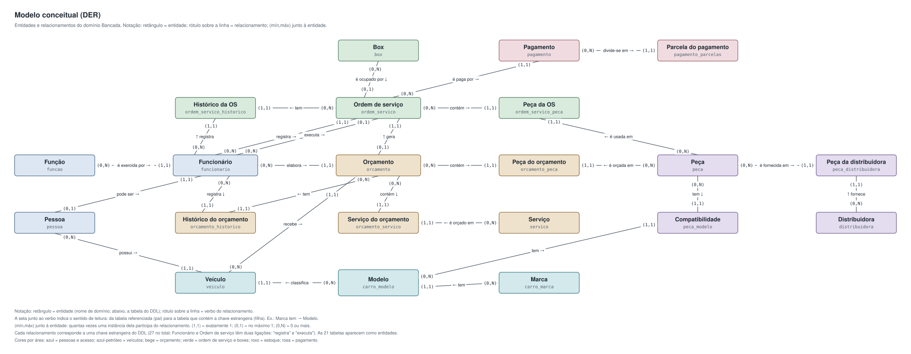
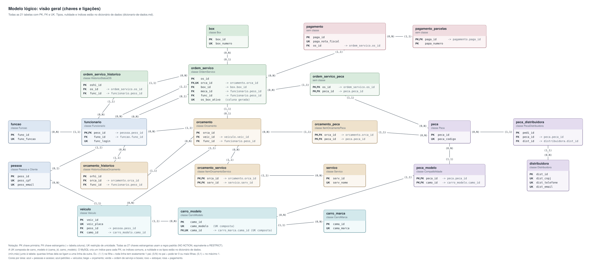

# Banco de dados

Contexto: Fábrica de Software I · projeto Bancada (Gestão de Oficina Mecânica) · modelagem relacional (SGBD MySQL 8, InnoDB).

O banco é descrito em quatro artefatos. O script [schema.sql](schema.sql) é a fonte de verdade; os demais documentos o descrevem e foram conferidos contra ele e contra um banco MySQL 8.0.46 criado a partir dele (21 tabelas, 155 colunas, 27 chaves estrangeiras, 17 restrições `CHECK` e 5 gatilhos). O script está na versão ajustada, que acrescenta restrições de integridade ao DDL do Milestone 2 (ver [Ajustes sobre o DDL do Milestone 2](#ajustes-sobre-o-ddl-do-milestone-2)).

| Artefato | Conteúdo |
|---|---|
| [modelo-conceitual.svg](modelo-conceitual.svg) | Entidades do domínio e seus relacionamentos, sem tipos de coluna. |
| [modelo-logico.svg](modelo-logico.svg) | Tabelas, chaves primárias, chaves estrangeiras e chaves únicas. |
| [dicionario-de-dados.md](dicionario-de-dados.md) | Todas as tabelas e colunas, com tipo, nulidade, default, chaves e origem no modelo de classes. |
| [schema.sql](schema.sql) | Script de criação do banco na versão ajustada, com cabeçalho que registra as convenções de nome. |

## SGBD e ferramentas

| Item | Escolha | Observação |
|---|---|---|
| SGBD | MySQL 8, a partir da versão 8.0.16 | InnoDB, `utf8mb4`, chaves estrangeiras, `CHECK`, coluna gerada e gatilhos. A partir da 8.0.16 o MySQL impõe o `CHECK`; nas versões anteriores ele é aceito e ignorado. O script foi conferido no MySQL 8.0.46. |
| Script do banco | [schema.sql](schema.sql) | Cria o banco `oficina_carro`, as 21 tabelas, os índices, as 27 chaves estrangeiras, as 17 restrições `CHECK` e os 5 gatilhos. A versão ajustada parte do DDL do Milestone 2. O script falha se o banco já existir, porque o `CREATE DATABASE` não tem `IF NOT EXISTS`. Os gatilhos usam `DELIMITER $$`, comando do cliente `mysql` e do Workbench. |
| Modelagem visual | MySQL Workbench | O modelo do Workbench do Milestone 2 não reflete os ajustes. Este pacote foi conferido contra o `schema.sql`, e não contra o arquivo do Workbench. |
| Charset e collation | `utf8mb4`; collation padrão do servidor | O DDL declara `DEFAULT CHARSET = utf8mb4` e não declara collation. Vale a padrão do MySQL 8.0, `utf8mb4_0900_ai_ci`, que ignora maiúsculas, minúsculas e acentos nas comparações. |
| ORM e migrações | Nenhum definido | Não há código de aplicação (lacuna L-12) nem migrações: o banco nasce do script. |

## Decisões de mapeamento (domínio para relacional)

O DDL não registra o motivo de cada escolha. A coluna "Efeito" descreve o que a escolha causa no banco.

| Decisão | Escolha | Efeito |
|---|---|---|
| Chave primária | `INT AUTO_INCREMENT` (`<prefixo>_id`). Exceções: `funcionario`, cuja chave é `pess_id`, e as tabelas de associação `orcamento_peca`, `orcamento_servico`, `ordem_servico_peca`, `peca_modelo` e `pagamento_parcelas`, com chave composta | O banco gera os identificadores. A chave composta impede repetir o mesmo par, como a mesma peça no mesmo orçamento. |
| Nomes | Tabelas em `snake_case`, no singular; colunas em minúsculas com o prefixo da tabela (`pess_nome`, `orca_status`); colunas de auditoria em maiúsculas (`PESS_CRIADO_EM`) | Os prefixos estão no cabeçalho de [schema.sql](schema.sql). O MySQL não diferencia maiúsculas e minúsculas em nomes de coluna, por isso a mistura não causa erro, mas dificulta a leitura das consultas. |
| Pessoa e cliente | Uma só tabela, `pessoa` | O cliente é a pessoa ligada a um veículo por `veiculo.pess_id`; não existe tabela `cliente` (N-01). |
| Funcionário | `funcionario` com chave primária `pess_id`, que também é chave estrangeira para `pessoa` (1:1); a função fica em `funcao` | Todo funcionário é uma pessoa cadastrada. Login e senha são opcionais e só existem juntos (`ck_func_acesso`). A senha é texto de até 100 posições, e o banco não verifica se é um hash. |
| Mecânico | Funcionário designado em `ordem_servico.meca_id` | Mecânico é um valor de `funcao`, e não uma classe (N-12). O banco não verifica se o funcionário designado tem essa função. |
| Endereço | Colunas embutidas em `pessoa` (`pess_cep`, `pess_en_*`) e em `distribuidora` (`dist_cep`, `dist_en_*`) | Não há tabela de endereço nem colunas de cidade e UF. |
| Listas de valores | `VARCHAR(20)` com `CHECK ... IN (...)`, e não `ENUM` | O MySQL recusa o valor fora da lista. A comparação ignora maiúsculas e acentos (ver [Listas de valores e restrições](#listas-de-valores-e-restrições)). |
| Ocupação do box | Sem coluna de status. A coluna gerada `ordem_servico.os_box_ativo` recebe `box_id` quando a OS está `em execução`, e a chave única `uk_os_box_ativo` completa a regra | Um box não tem duas OS em execução ao mesmo tempo (RF-03), sem coluna de status para manter em sincronia. |
| OS só de orçamento aprovado | Gatilho `tg_os_bi_orcamento_aprovado` (`BEFORE INSERT`, erro 45000) e chave única `uk_os_orcamento` | A OS só nasce de um orçamento aprovado, e há no máximo uma por orçamento. O comentário do DDL diz que o gatilho foi criado "apenas para entendimento didático"; ele funciona. |
| Ordem dos status | Gatilhos `tg_orca_bi_status_inicial`, `tg_orca_bu_transicao`, `tg_os_bi_status_inicial` e `tg_os_bu_transicao` | O orçamento nasce `aberto` e muda na ordem aberto, orçado, aprovado ou recusado. A OS nasce `aberta` e muda na ordem aberta, em execução, concluída, sem trocar de orçamento. A recusa só vale depois de `orçado` (lacuna L-05). |
| Meio da resposta do cliente | Coluna `orca_meio_resposta`, nula até a resposta, com `ck_orca_meio` e `ck_orca_decisao` | O orçamento aprovado ou recusado tem o meio da resposta (presencial, telefone ou mensagem), como pede a RF-02. |
| Coerência da OS | `ck_os_execucao`, `ck_os_conclusao` e `ck_os_periodo` | A OS em execução ou concluída tem box, mecânico e início; a concluída tem fim, e o fim não vem antes do início. |
| Valores não negativos | `ck_orca_valores`, `ck_peca_valores`, `ck_serv_valor`, `ck_orpe_valores`, `ck_orse_valor` e `ck_ospe_valores` | Valores, preços e quilometragem não negativos; quantidades de item maiores que zero. Ficam de fora os valores de `peca_distribuidora` e de `pagamento`. |
| Histórico de status | Tabelas `orcamento_historico` e `ordem_servico_historico`, com o novo status, o funcionário e a data e hora | Nenhum gatilho as preenche: a gravação é da aplicação. |
| Valor do orçamento | `orca_valor DECIMAL(10,2)`, gravado pela aplicação | Nenhuma restrição o liga à soma dos itens. |
| Valores monetários | `DECIMAL(10,2)` | Valores exatos, com duas casas decimais, até 99.999.999,99. |
| Datas e auditoria | `DATETIME` com `DEFAULT CURRENT_TIMESTAMP`; `*_ATUALIZADO_EM` com `ON UPDATE CURRENT_TIMESTAMP` | O banco preenche a data de criação e a de alteração. Não há fração de segundo nem fuso horário. |
| Texto livre | `pess_ct_preferencial`, `orca_formato`, `paga_metodo` e `paga_status` | Sem lista de valores: o banco aceita qualquer texto dentro do tamanho da coluna. |
| Exclusão lógica | Só `peca.peca_ativo` | As demais tabelas não têm coluna de desativação (ver [Exclusão lógica](#exclusão-lógica-e-registros-que-não-são-apagados)). |

## Listas de valores e restrições

| Tabela | Restrição | Valores |
|---|---|---|
| `orcamento` | `ck_orca_status` | `aberto`, `orçado`, `aprovado`, `recusado` |
| `orcamento` | `ck_orca_meio` | `presencial`, `telefone`, `mensagem`, ou nulo até a resposta |
| `orcamento_historico` | `ck_orhi_status` | `aberto`, `orçado`, `aprovado`, `recusado` |
| `ordem_servico` | `ck_os_status` | `aberta`, `em execução`, `concluída` |
| `ordem_servico_historico` | `ck_oshi_status` | `aberta`, `em execução`, `concluída` |

As outras restrições, de integridade e de valores, estão em [Regras que o banco garante](#regras-que-o-banco-garante). Todas, com a expressão exata, estão no [dicionário de dados](dicionario-de-dados.md#listas-de-valores-e-restrições).

Os literais de status são os do glossário. As transições entre eles, descritas em [Máquinas de estados](../05-modelagem/estados/README.md), são impostas por gatilhos. Por causa da collation padrão, o valor `ORCADO`, sem acento e em maiúsculas, passa pelo `CHECK` e pelos gatilhos e é gravado como foi enviado.

## Modelos (tabelas)

Vinte e uma tabelas, agrupadas por área. A coluna "Classe" indica a classe de domínio correspondente.

| Grupo | Tabela | Classe | O que guarda |
|---|---|---|---|
| Pessoas e acesso | [pessoa](dicionario-de-dados.md#pessoa) | Pessoa e Cliente | Pessoas cadastradas, clientes e funcionários, com o endereço embutido. |
| | [funcionario](dicionario-de-dados.md#funcionario) | Funcionario | Funcionário: pessoa com função, login, senha e horário de trabalho. |
| | [funcao](dicionario-de-dados.md#funcao) | Funcao | Funções (cargos) dos funcionários. |
| Veículos | [carro_marca](dicionario-de-dados.md#carro_marca) | CarroMarca | Marcas de veículo. |
| | [carro_modelo](dicionario-de-dados.md#carro_modelo) | CarroModelo | Modelos de veículo, cada um de uma marca. |
| | [veiculo](dicionario-de-dados.md#veiculo) | Veiculo | Veículos dos clientes, identificados pela placa. |
| Orçamento | [servico](dicionario-de-dados.md#servico) | Servico | Serviços (mão de obra) que podem ser cobrados. |
| | [orcamento](dicionario-de-dados.md#orcamento) | Orcamento | Orçamento, com status, meio da resposta, valor, formato e quilometragem. |
| | [orcamento_peca](dicionario-de-dados.md#orcamento_peca) | ItemOrcamentoPeca | Peças do orçamento, com quantidade e preço unitário. |
| | [orcamento_servico](dicionario-de-dados.md#orcamento_servico) | ItemOrcamentoServico | Serviços do orçamento, com o valor cobrado. |
| | [orcamento_historico](dicionario-de-dados.md#orcamento_historico) | HistoricoStatusOrcamento | Status assumidos pelo orçamento, com funcionário e data e hora. |
| Ordem de serviço e boxes | [box](dicionario-de-dados.md#box) | Box | Boxes da oficina. |
| | [ordem_servico](dicionario-de-dados.md#ordem_servico) | OrdemServico | Ordem de serviço, gerada por um orçamento aprovado, com box e mecânico. |
| | [ordem_servico_peca](dicionario-de-dados.md#ordem_servico_peca) | Sem classe | Peças usadas na OS, com quantidade e preço unitário. |
| | [ordem_servico_historico](dicionario-de-dados.md#ordem_servico_historico) | HistoricoStatusOS | Status assumidos pela OS, com funcionário e data e hora. |
| Estoque | [peca](dicionario-de-dados.md#peca) | Peca | Peças, com estoque, estoque mínimo, preço e desativação lógica. |
| | [peca_modelo](dicionario-de-dados.md#peca_modelo) | Compatibilidade | Modelos de carro compatíveis com cada peça. |
| | [distribuidora](dicionario-de-dados.md#distribuidora) | Distribuidora | Distribuidoras (fornecedoras), com o endereço embutido. |
| | [peca_distribuidora](dicionario-de-dados.md#peca_distribuidora) | PecaDistribuidora | Peças fornecidas por uma distribuidora, com quantidade e custo unitário. |
| Pagamento | [pagamento](dicionario-de-dados.md#pagamento) | Sem classe | Pagamento de uma OS, à vista ou parcelado. |
| | [pagamento_parcelas](dicionario-de-dados.md#pagamento_parcelas) | Sem classe | Parcelas de um pagamento. |

## Política de exclusão

| Regra (`ON DELETE`) | Onde se aplica | Efeito |
|---|---|---|
| `RESTRICT` (padrão `NO ACTION`) | As 27 chaves estrangeiras | O banco não apaga nem altera a chave de uma linha que ainda é referenciada. |
| `CASCADE` e `SET NULL` | Nenhuma | Não há exclusão em cascata nem perda de referência. |

O DDL não declara `ON DELETE` nem `ON UPDATE`. No InnoDB o padrão é `NO ACTION`, que se comporta como `RESTRICT`.

> [!WARNING]
> Sem `CASCADE`, o `DELETE` de um registro com dependentes falha. Para apagar um orçamento, é preciso apagar antes os itens, o histórico e a OS dele, e, para apagar a OS, o pagamento, as parcelas, as peças e o histórico dela. Uma peça já usada em orçamento, OS, compatibilidade ou fornecimento não pode ser apagada: o caminho é `peca_ativo = FALSE`. Um funcionário que elaborou orçamentos ou registrou OS não pode ser apagado, e o banco não tem coluna para desativá-lo.

## Exclusão lógica e registros que não são apagados

- A única coluna de desativação lógica do banco é `peca.peca_ativo`, verdadeira por padrão. Não há `deletedAt` nem exclusão lógica genérica.
- As classes `Cliente` e `Funcionario` têm o atributo `ativo`, mas `pessoa` e `funcionario` não têm coluna equivalente. Como as chaves estrangeiras são `RESTRICT`, uma pessoa com veículo ou histórico não pode ser apagada nem desativada pelo banco (divergência 2).
- A recusa do orçamento é um status (`recusado`), e não uma exclusão. A OS termina em `concluída`, e a lista de status dela não tem valor de cancelamento.
- As tabelas de histórico têm só `_CRIADO_EM`, sem `_ATUALIZADO_EM`, e o banco não impede alterar ou apagar uma linha delas.

## Auditoria

Toda tabela tem `<PREFIXO>_CRIADO_EM`, e todas, exceto `orcamento_historico` e `ordem_servico_historico`, têm também `<PREFIXO>_ATUALIZADO_EM`. O banco preenche as duas: a de criação com `CURRENT_TIMESTAMP`, e a de alteração com `ON UPDATE CURRENT_TIMESTAMP`. Essas colunas registram quando, e não quem. Quem agiu aparece em `orcamento.func_id` (elaborou), `ordem_servico.func_id` (registrou) e `meca_id` (executa), e em `func_id` nas tabelas de histórico (responsável pela mudança). Não há tabela de auditoria separada.

Em três tabelas a data de criação tem sentido de negócio na classe: `ORCA_CRIADO_EM` é a `dataEmissao` do orçamento, `OS_CRIADO_EM` é a `dataAbertura` da OS, e `ORHI_CRIADO_EM` e `OSHI_CRIADO_EM` são a `dataHora` dos históricos.

## Índices

O DDL não registra a consulta que motivou cada índice. A coluna "Consulta que atende" descreve o uso natural das colunas indexadas e não é uma decisão registrada pelo grupo.

| Tabela | Índice | Consulta que atende |
|---|---|---|
| `orcamento` | `ix_orcamento_01` (`orca_status`) | Listagem de orçamentos por status. |
| `orcamento` | `ix_orcamento_02` (`ORCA_CRIADO_EM`) | Listagem de orçamentos por data de emissão. |
| `orcamento_historico` | `ix_orcamento_orhi` (`orca_id`, `ORHI_CRIADO_EM`) | Status de um orçamento, em ordem cronológica. |
| `ordem_servico_historico` | `ix_os_oshi` (`os_id`, `OSHI_CRIADO_EM`) | Status de uma OS, em ordem cronológica. |
| `peca` | `ix_nome_peca`, `ix_cate_peca`, `ix_esto_peca` | Busca por nome, filtro por categoria e consulta por quantidade em estoque. |
| `ordem_servico` | `UK (os_box_ativo)`, `UK (orca_id)` | Uma OS em execução por box; uma OS por orçamento. |
| `pessoa`, `veiculo`, `peca`, `box`, `funcionario` | `UK` em `pess_cpf`, `pess_email`, `veic_placa`, `peca_codigo`, `box_numero`, `func_login` | Cadastro sem repetição e busca direta por CPF, e-mail, placa, código, número do box e login. |
| Demais tabelas | `UK` em `dist_cnpj`, `dist_email`, `dist_telefone`, `serv_nome`, `funo_funcao`, `cama_marca`, `(cama_id, camo_modelo)`, `paga_nota_fiscal` | Cadastro sem repetição. |
| Chaves estrangeiras | `ix_*` e `fk_veic_pessoa` | Sustentam as junções e a verificação das chaves estrangeiras. O InnoDB exige um índice em cada coluna de chave estrangeira; o `fk_veic_pessoa` foi criado pelo próprio MySQL, porque o DDL não tem índice para `veiculo.pess_id`. |

A ordem das colunas importa: o MySQL usa o índice a partir do prefixo mais à esquerda. Todos os índices e chaves únicas estão no [dicionário](dicionario-de-dados.md) e no [schema.sql](schema.sql).

## Regras de negócio e o que o banco garante

Cada linha das duas tabelas abaixo foi verificada com uma inserção ou uma alteração de teste em um MySQL 8.0.46 criado a partir do DDL ajustado. "Requisito" remete aos [requisitos funcionais](../03-requisitos/requisitos-funcionais.md) e aos [não funcionais](../03-requisitos/requisitos-nao-funcionais.md).

### Regras que o banco garante

| Regra | Requisito | Como o banco a impõe |
|---|---|---|
| CPF, e-mail, placa, código da peça, número do box e os demais cadastros sem repetição | RF-01, RF-03, RF-05 | Chave única (`UK`) |
| Login e senha preenchidos juntos | RNF-02 | `ck_func_acesso` |
| Estoque da peça não negativo | RF-05 | `ck_peca_estoque` |
| Status do orçamento, da OS e dos históricos dentro da lista | RF-02, RF-06 | `ck_orca_status`, `ck_os_status`, `ck_orhi_status` e `ck_oshi_status` |
| O orçamento nasce `aberto` e muda na ordem aberto, orçado, aprovado ou recusado | RF-02 | Gatilhos `tg_orca_bi_status_inicial` e `tg_orca_bu_transicao` |
| A OS nasce `aberta` e muda na ordem aberta, em execução, concluída | RF-06 | Gatilhos `tg_os_bi_status_inicial` e `tg_os_bu_transicao` |
| A OS só nasce de um orçamento aprovado e não troca de orçamento depois | RF-02, RF-06 | Gatilhos `tg_os_bi_orcamento_aprovado` e `tg_os_bu_transicao` |
| No máximo uma OS por orçamento | RF-02 | `uk_os_orcamento` |
| Um box não tem duas OS em execução ao mesmo tempo, e volta a ser usado depois da conclusão | RF-03 | Coluna gerada `os_box_ativo` e `uk_os_box_ativo` |
| A OS em execução ou concluída tem box, mecânico e início | RF-03 | `ck_os_execucao` |
| A OS concluída tem fim, e o fim não vem antes do início | RF-03, RF-06 | `ck_os_conclusao` e `ck_os_periodo` |
| O orçamento aprovado ou recusado tem o meio da resposta, entre presencial, telefone e mensagem | RF-02 | `ck_orca_meio` e `ck_orca_decisao` |
| Valor e quilometragem do orçamento, preço e estoque mínimo da peça, valor do serviço e valores dos itens não negativos; quantidade dos itens maior que zero | RF-02, RF-05 | `ck_orca_valores`, `ck_peca_valores`, `ck_serv_valor`, `ck_orpe_valores`, `ck_orse_valor` e `ck_ospe_valores` |
| A mesma peça ou o mesmo serviço não se repete no mesmo orçamento | RF-02 | Chave primária composta |
| Não se apaga o que ainda é referenciado, e o funcionário aponta para uma pessoa cadastrada | RNF-05 | Chaves estrangeiras (`RESTRICT`) |

### Regras que o banco não garante

| Regra | Requisito | O que o banco aceita hoje |
|---|---|---|
| O mecânico da OS tem a função Mecânico | RF-03 | Qualquer funcionário em `meca_id`. |
| Toda mudança de status gera uma linha de histórico | RF-02, RF-06 | Mudança de status sem linha de histórico: a gravação do histórico é da aplicação. |
| Valores não negativos nas compras de distribuidora e nos pagamentos | RF-05; pagamento sem requisito (L-16) | Quantidade e custo unitário de `peca_distribuidora`, e valores de `pagamento` e de `pagamento_parcelas`, negativos. |
| Status escrito exatamente como na lista | RF-02, RF-06 | `ORCADO` passa pelo `CHECK` e pelos gatilhos por causa da collation e é gravado como foi enviado. |
| O valor do orçamento é a soma dos itens | RF-02 | Qualquer valor não negativo em `orca_valor`. |
| Pagamento com status e parcelas coerentes | Sem requisito (L-16) | `paga_status` livre; parcelas em pagamento marcado como não parcelado. |

O formato do orçamento (`orca_formato`) também é texto livre, mas não é uma regra de negócio descumprida: o significado da coluna aguarda confirmação (divergência 1).

## Ajustes sobre o DDL do Milestone 2

O DDL do Milestone 2 já tinha as chaves, os índices e seis restrições `CHECK`, mas aceitava, por exemplo, uma OS `em execução` sem box nem mecânico, ou um orçamento que pulava etapas do ciclo. A versão ajustada acrescenta o que está abaixo, sem alterar as tabelas, as colunas e as chaves que já existiam.

| Ajuste | O que faz | Depende de |
|---|---|---|
| `ck_os_execucao`, `ck_os_conclusao` e `ck_os_periodo` | A OS em execução ou concluída tem box, mecânico e início; a concluída tem fim, e o fim não vem antes do início. | Nada pendente. |
| `ck_orca_valores`, `ck_peca_valores`, `ck_serv_valor`, `ck_orpe_valores`, `ck_orse_valor` e `ck_ospe_valores` | Valores e quilometragem não negativos; quantidades de item maiores que zero. | Nada pendente. |
| `tg_orca_bi_status_inicial`, `tg_orca_bu_transicao`, `tg_os_bi_status_inicial` e `tg_os_bu_transicao` | Os status nascem `aberto` e `aberta` e mudam só na ordem do ciclo; a OS não troca de orçamento. | Lacuna L-05: os gatilhos adotam a recusa só depois de `orçado`. |
| `orca_meio_resposta`, `ck_orca_meio` e `ck_orca_decisao` | Coluna nova para o meio da resposta do cliente (RF-02); aprovar ou recusar exige o meio. | Divergência 1: parte de `orca_formato` ser o formato do orçamento. |

Se a decisão da lacuna L-05 for outra, o gatilho `tg_orca_bu_transicao` precisa mudar. Se `orca_formato` for, de fato, o meio da resposta, a coluna `orca_meio_resposta` e as duas restrições que a usam devem ser removidas, e a lista de valores passa para a coluna existente: `ALTER TABLE orcamento ADD CONSTRAINT ck_orca_formato CHECK (orca_formato IN ('presencial', 'telefone', 'mensagem'));`.

Quem já criou o banco com o DDL anterior precisa recriá-lo ou aplicar os ajustes com `ALTER TABLE` e `CREATE TRIGGER`; em uma base com dados, é preciso conferir antes se as linhas existentes respeitam as novas restrições.

## Divergências

Divergências encontradas entre a documentação existente, o modelo de classes e o DDL. Quando houve conflito, este documento segue o DDL.

1. **`orca_formato`: formato do orçamento ou meio da resposta.** A [RF-02](../03-requisitos/requisitos-funcionais.md), a [visão do projeto](../01-visao/README.md) e a OCL (N-05 e D-06) tratam a coluna como o meio da resposta do cliente (presencial, telefone ou mensagem). O protótipo e a lacuna L-07 a tratam como o "Formato" do orçamento ("Valor fixo", tela "Montar o orçamento"). O DDL só declara texto obrigatório de até 20 posições, sem lista de valores. O significado não está confirmado; o dicionário descreve a coluna pelo nome e pela tela. A coluna é obrigatória desde a criação do orçamento, antes de qualquer resposta do cliente, o que combina com o formato. O DDL ajustado adota essa leitura: `orca_formato` continua como texto livre, e o meio da resposta ganhou a coluna `orca_meio_resposta`.
2. **Atributos de classe sem coluna.** `Cliente.dataCadastro` e `ativo`; `Funcionario.ativo`; `Orcamento.numero` e `observacoes`; `OrdemServico.numero`; `Veiculo.quilometragem` (o banco guarda a quilometragem só no orçamento, em `orca_quilometragem`); `CarroModelo.anoInicio` e `anoFim`; `ItemOrcamentoServico.quantidade` (N-07); `Compatibilidade.observacao`; `Distribuidora.contatoPreferencial`; `PecaDistribuidora.dataCotacao` (existe só `PEDI_CRIADO_EM`, a confirmar); `Endereco.cidade` e `uf`; `Box.status` (lacuna L-13: a ocupação deriva de `ordem_servico.os_box_ativo`); `statusAnterior` em `HistoricoStatusOS` e `HistoricoStatusOrcamento` (N-11).
3. **Colunas sem atributo na classe.** `os_inicio`, `orca_formato`, `orca_meio_resposta` e `peca_ativo` (L-07); `ordem_servico.func_id`, o funcionário que registra a OS, sem associação na classe; e as colunas de auditoria `*_ATUALIZADO_EM`.
4. **Tabelas sem classe.** `ordem_servico_peca` (L-07), `pagamento` e `pagamento_parcelas` (L-16 e N-14, sem requisito).
5. **Nomes diferentes entre classe e banco (L-15).** `Funcionario.matricula` e o banco `func_login`; `Peca.tipo` e o banco `peca_categoria`; `Servico.valorMaoDeObra` e o banco `serv_valor`. As demais diferenças estão em [divergencias-m2.md](../05-modelagem/ocl/divergencias-m2.md).
6. **Endereço embutido.** No diagrama de classes, `Endereco` é uma classe separada, em composição com `Pessoa` e com `Distribuidora`. No banco, o endereço está nas colunas de `pessoa` e `distribuidora`, sem tabela própria, e as colunas de cidade e UF não existem.
7. **Valor do orçamento.** A classe `Orcamento` tem a operação `calcularTotal()`, e o banco grava `orca_valor` sem vínculo com os itens. A tela "Montar o orçamento" registra um valor fixo (L-10).

## Veja também

- [Dicionário de dados](dicionario-de-dados.md) e [schema.sql](schema.sql)
- [Modelo de classes](../05-modelagem/classes/README.md), que usa os nomes de classe desta lista
- [Casos de uso](../05-modelagem/casos-de-uso/README.md) e [requisitos funcionais](../03-requisitos/requisitos-funcionais.md)
- [Lacunas](../07-rastreabilidade/lacunas.md) e [divergências de nomes](../05-modelagem/ocl/divergencias-m2.md)
- [Decisões de arquitetura (ADR)](../adr/README.md)
- [Rastreabilidade](../07-rastreabilidade/matriz.md)
